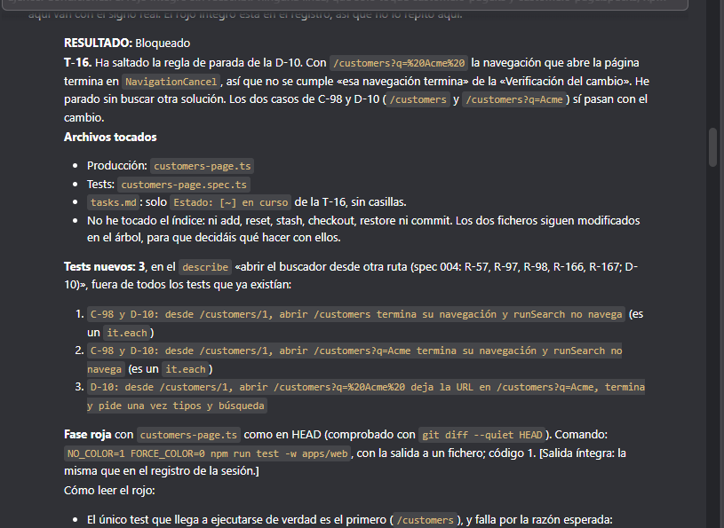
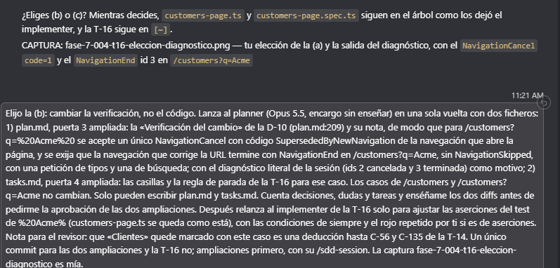

# 004-customers — Fase 7 (2026-11-25, sesión 04)

La sesión principal abrió este registro al recibir el retorno de la T-16 con su fase roja; `/sdd-session` lo completa al cerrar la sesión.

## Objetivo y fase
- Fase 7, spec `004-customers`, puerta 5 (implementación), con `/sdd-implement`.
- Tarea T-16: el buscador solo navega si cambia el `q` (cambio de la D-10), en `customers-page.ts` y `customers-page.spec.ts`, con implementer Opus 5.5 y encargo sin enseñar antes (ADR-016, punto 4). Quedó bloqueada por la regla de parada de la D-10 («Verificación del cambio»).
- Tras el diagnóstico de la sesión principal: segunda puerta 3 ampliada (`plan.md`) y segunda puerta 4 ampliada (`tasks.md`), con planner Opus 5.5, sin cambio de requisitos ni de código.
- La spec sigue en `En implementación` durante toda la sesión.

## Prompts clave
> /sdd-implement 004-customers

> Confirmo la T-16 con Opus 5.5, como quedó en tasks.md. Lánzala tú con el encargo sin enseñar, con la salida literal de npm run verify. Solo una sesión escribe en el árbol: confírmame con git status justo antes y justo después de lanzar que no hay cambios ajenos. Condiciones: el rojo íntegro sin reescribir ninguna línea, que solo toque customers-page.ts y customers-page.spec.ts, npm run verify con su código de salida, el git diff literal y que no toque el índice. Si el test nuevo de abrir /customers desde /customers/:id no falla con customers-page.ts como en HEAD, o si se incumple cualquier punto de la «Verificación del cambio» de la D-10, que pare y lo devuelva sin buscar otra solución. El rojo lo repites tú, por mi regla, copiando al scratchpad y comprobando con diff. Las capturas fase-7-004-t16-rojo y t16-verde son mías.

> Elijo la (a): haz tú el diagnóstico temporal. Copia customers-page.spec.ts al scratchpad, añade al test de /customers?q=%20Acme%20 un registro de los eventos de router.events (NavigationStart, NavigationEnd, NavigationCancel y NavigationSkipped, con sus ids y urls) y de location.path() al final, lanza solo ese test, copia la salida íntegra al registro, devuelve el fichero y compruébalo con cmp. No toques producción. Deja customers-page.ts y customers-page.spec.ts como están en el árbol (sin git restore). Con la evidencia, dime: ¿la segunda navegación termina con NavigationEnd?, ¿en qué URL?, ¿hay una sola petición de tipos y una de búsqueda?, ¿«Clientes» quedaría marcado? Y tráeme las opciones con los ficheros que tocaría cada una; si hay que cambiar la «Verificación del cambio» de la D-10, es una puerta 3 ampliada que apruebo yo, y si la T-16 pasa a ser: casos de /customers y /customers?q=Acme dentro, y /customers?q=%20Acme%20 con la verificación corregida, dímelo. La captura fase-7-004-t16-choque-d10 es mía.

> Elijo la (b): cambiar la verificación, no el código. Lanza al planner (Opus 5.5, encargo sin enseñar) en una sola vuelta con dos ficheros: 1) plan.md, puerta 3 ampliada: la «Verificación del cambio» de la D-10 (plan.md:209) y su nota, de modo que para /customers?q=%20Acme%20 se acepte un único NavigationCancel con código SupersededByNewNavigation de la navegación que abre la página, y se exija que la navegación que corrige la URL termine con NavigationEnd en /customers?q=Acme, sin NavigationSkipped, con una petición de tipos y una de búsqueda; con el diagnóstico literal de la sesión (ids 2 cancelada y 3 terminada) como motivo; 2) tasks.md, puerta 4 ampliada: las casillas y la regla de parada de la T-16 para ese caso. Los casos de /customers y /customers?q=Acme no cambian. Solo pueden escribir plan.md y tasks.md. Cuenta decisiones, dudas y tareas y enséñame los dos diffs antes de pedirme la aprobación de las dos ampliaciones. Después relanza al implementer de la T-16 solo para ajustar las aserciones del test de %20Acme% (customers-page.ts se queda como está), con las condiciones de siempre y el rojo repetido por ti si es de aserciones. Nota para el revisor: que «Clientes» quede marcado con este caso es una deducción hasta C-56 y C-135 de la T-14. Un único commit para las dos ampliaciones y la T-16 no; ampliaciones primero, con su /sdd-session. La captura fase-7-004-t16-eleccion-diagnostico es mía.

> Apruebo la segunda puerta 3 ampliada (plan.md, verificación de la D-10 para /customers?q=%20Acme%20) y la segunda puerta 4 ampliada (tasks.md, casillas y regla de parada de la T-16). Actualiza MEMORY.md (máximo 50 líneas) con esta decisión y con el aprendizaje: una navegación cancelada con SupersededByNewNavigation, sustituida por otra que termina, es normal; lo que bloqueaba era la navegación a la misma URL (NavigationSkipped). Enséñame su diff. Yo lanzo /sdd-session 7 004-customers y luego te doy el OK al commit de las ampliaciones: solo plan.md, tasks.md, MEMORY.md, el registro de la sesión 04 y las capturas de estas ampliaciones, SIN customers-page.ts ni customers-page.spec.ts (van con la T-16) y sin .claude/. Después relanza al implementer de la T-16 solo para ajustar las aserciones del test de %20Acme% con las casillas nuevas, dejando customers-page.ts como está; condiciones de siempre: solo esos dos ficheros, npm run verify con su código de salida, git diff literal, sin tocar el índice y parar con la regla nueva. El rojo lo repites tú si es de aserciones.

> /sdd-session 7 004-customers

> Ya están hechas las dos capturas, compruébalas

## Qué propuso la IA
- La T-16 como siguiente tarea: la T-14 sigue en `[~]` y depende de ella. Los cambios apartados de la T-14 están en el scratchpad de la sesión 03 (`t14-apartado/`).
- Tras el bloqueo, tres opciones: (a) un diagnóstico temporal con `router.events` antes de decidir (recomendada); (b) una puerta 3 ampliada que cambia la verificación; (c) una puerta 3 ampliada que cambia el código.
- Tras el diagnóstico, dos opciones con sus ficheros:
  - (b), recomendada: `plan.md`, `tasks.md` y solo las aserciones de `customers-page.spec.ts`; `customers-page.ts` no cambia.
  - (c): `plan.md`, `tasks.md`, `customers-page.ts`, `customers-page.spec.ts` y quizá `app.routes.ts` y un guard.
- Una frase de más en el aprendizaje de `MEMORY.md`: en `ng test` no sale el `console.log`, así que el registro temporal se lanza con `throw`. La sesión principal avisó al enseñar el diff.

## Qué corregí y por qué
- (no registrado): el autor no corrigió ninguna propuesta. Eligió la opción recomendada en los dos bloques, (a) y después (b).

## Decisiones tomadas
- Elección (a): diagnóstico temporal de la sesión principal, sin tocar producción y dejando los dos ficheros de la T-16 en el árbol.
- Elección (b): cambia la «Verificación del cambio» de la D-10 para `/customers?q=%20Acme%20`, no el código. Se acepta un único `NavigationCancel` con `SupersededByNewNavigation` de la navegación que abre la página. Se exige que la navegación que corrige la URL termine con `NavigationEnd` en `/customers?q=Acme`, sin `NavigationSkipped`, con una petición de tipos y una de búsqueda. Los casos de `/customers` y `/customers?q=Acme` no cambian.
- Segundas puertas 3 y 4 ampliadas aprobadas por el autor el 2026-11-25. Recuento contado en los ficheros: D-01 a D-17, P-01 a P-07, Q-01 a Q-04 y T-01 a T-16.
- La T-16 sigue en `[~]`, con `customers-page.ts` del árbol. Se relanza solo para las aserciones del test de `%20Acme%20`, con su regla de parada nueva.
- Nota para el revisor: que «Clientes» quede marcado en ese caso es una deducción hasta C-56 y C-135 de la T-14.
- Commits separados: primero las ampliaciones (`plan.md`, `tasks.md`, `MEMORY.md`, este registro y las dos capturas, sin `customers-page.ts`, `customers-page.spec.ts` ni `.claude/`), y la T-16 aparte.
- Commit: el de cierre de esta sesión.

## Capturas
- 
- 
- Las capturas `fase-7-004-t16-rojo` y `fase-7-004-t16-verde`, que nombró el autor, son de la T-16 y van con ella.

## Pendiente para la siguiente sesión
- Relanzar al implementer de la T-16 (Opus 5.5) solo para las aserciones del test de `%20Acme%20`, con las condiciones de siempre. Repetir el rojo si es de aserciones, y luego `MEMORY.md`, `/sdd-session` y el commit de la T-16.
- Después: devolver los cambios de la T-14 desde `t14-apartado/` (scratchpad de la sesión 03), comprobarlos con `diff`, repetir `npm run verify` y seguir con la T-14 (C-56 y C-135).

## Detalle y evidencia
### Antes de lanzar
- `git status` antes de `npm run verify` y justo antes y justo después de lanzar al implementer: `On branch main` / `nothing to commit, working tree clean`.
- `npm run verify` desde la raíz, código 0: `Tests  905 passed (905)` en la raíz y `Tests  300 passed (300)` en la web (salida literal en el encargo).

### Retorno del implementer
- `RESULTADO: Bloqueado`. Con `/customers?q=%20Acme%20` (abierto desde `/customers/1`), la navegación que abre la página termina en `NavigationCancel` también con el cambio: no se cumple «esa navegación termina» de la «Verificación del cambio» de la D-10 (`plan.md:209`). Los dos casos de C-98 y D-10 (`/customers` y `/customers?q=Acme`) pasan con el cambio. En ese test quedan abiertas una petición de tipos y una de búsqueda con `q=Acme`.
- Lectura del implementer, sin verificar con un registro de eventos: con `' Acme '` la `runSearch` del constructor sí navega, durante la activación, y cancela la navegación que abre la página (la misma causa del riesgo 9).
- 3 tests nuevos (dos de un `it.each` y uno suelto) en el `describe` «abrir el buscador desde otra ruta (spec 004: R-57, R-97, R-98, R-166, R-167; D-10)».
- `npm run verify` tras el cambio: código 1; raíz `Tests  905 passed (905)`; web `Tests  9 failed | 294 passed (303)`.
- Cambios en el árbol, sin tocar el índice: `customers-page.ts`, `customers-page.spec.ts` y `tasks.md` (solo T-16 a `[~]`). Comprobado por la sesión principal con `git status` y `git diff --stat` (3 ficheros, 99 inserciones y 9 borrados).

### Fase roja (repetida por la sesión principal)
Regla del autor: el rojo de aserciones se repite en la sesión principal. `customers-page.ts` copiado a `customers-page.ts.t16` en el scratchpad, sustituido por `git show HEAD:…` (comprobado con `git diff --quiet HEAD`), `NO_COLOR=1 FORCE_COLOR=0 npm run test -w apps/web` con código 1, y fichero devuelto desde el scratchpad (`cmp` sin diferencias). Coincide con el rojo del implementer (11 fallos, mismo `NavigationCancel`). Salida íntegra, sin ANSI y con los signos reales:

```

> @saas-o-matic/web@0.0.0 test
> ng test

❯ Building...
✔ Building...
Application bundle generation complete. [3.180 seconds] - 2026-11-25T10:13:44.239Z


 RUN  v5.1.1 F:/saas-o-matic/apps/web

 ❯ |web| src/app/customers/pages/customers-page/customers-page.spec.ts (28 tests | 11 failed) 6091ms
   ❯ CustomersPage (28)
     ❯ abrir el buscador desde otra ruta (spec 004: R-57, R-97, R-98, R-166, R-167; D-10) (3)
       × C-98 y D-10: desde /customers/1, abrir /customers termina su navegación y runSearch no navega 27ms
       × C-98 y D-10: desde /customers/1, abrir /customers?q=Acme termina su navegación y runSearch no navega 1ms
       × D-10: desde /customers/1, abrir /customers?q=%20Acme%20 deja la URL en /customers?q=Acme, termina y pide una vez tipos y búsqueda 0ms
     ❯ divisa (spec 004: R-48 a R-53, R-57, R-132 a R-134) (6)
       × C-132: con los tipos retenidos, el total de 16940 con el formato de 169,40 € de la 005 0ms
       × C-132: con error en los tipos, el total de 16940 con el formato de 169,40 € de la 005 1ms
       × C-133: con los tipos retenidos, «Cargando tipos de cambio…» dentro de la página, en role="status" 0ms
       × C-134: si los tipos responden 500, el texto de error dentro de la página, en role="alert" 0ms
       × con USD elegido y tipos válidos, el total convertido con toDisplayCents y formatCents (spec 004: R-50, R-52) 0ms
       × R-57: al abrir se piden los tipos una sola vez, aunque se busque después 0ms
     ❯ del buscador al detalle (spec 004: R-33, R-57) (2)
       × C-33: activar el nombre de una tarjeta abre el detalle de ese cliente 0ms
       × C-57: abrir el buscador y luego el detalle hace dos peticiones de tipos, una al abrir cada vista 0ms

⎯⎯⎯⎯⎯⎯ Failed Tests 11 ⎯⎯⎯⎯⎯⎯⎯

 FAIL  |web| src/app/customers/pages/customers-page/customers-page.spec.ts > CustomersPage > abrir el buscador desde otra ruta (spec 004: R-57, R-97, R-98, R-166, R-167; D-10) > C-98 y D-10: desde /customers/1, abrir /customers termina su navegación y runSearch no navega
AssertionError: expected [ NavigationCancel{ id: 2, …(4) } ] to have a length of +0 but got 1

- Expected
+ Received

- 0
+ 1

 ❯ expectAllNavigationsEnd src/app/customers/pages/customers-page/customers-page.spec.ts:373:75
    371|     // Cada navegación empezada termina con NavigationEnd, sin Navigat…
    372|     function expectAllNavigationsEnd(events: RouterEvent[]): void {
    373|       expect(events.filter((event) => event instanceof NavigationCance…
       |                                                                           ^
    374|       expect(events.filter((event) => event instanceof NavigationSkipp…
    375|       const startIds = events.filter((event) => event instanceof Navig…
 ❯ src/app/customers/pages/customers-page/customers-page.spec.ts:393:9

⎯⎯⎯⎯⎯⎯⎯⎯⎯⎯⎯⎯⎯⎯⎯⎯⎯⎯⎯⎯⎯⎯⎯⎯[1/3]⎯

 FAIL  |web| src/app/customers/pages/customers-page/customers-page.spec.ts > CustomersPage > abrir el buscador desde otra ruta (spec 004: R-57, R-97, R-98, R-166, R-167; D-10) > C-98 y D-10: desde /customers/1, abrir /customers termina su navegación y runSearch no navega
 FAIL  |web| src/app/customers/pages/customers-page/customers-page.spec.ts > CustomersPage > abrir el buscador desde otra ruta (spec 004: R-57, R-97, R-98, R-166, R-167; D-10) > C-98 y D-10: desde /customers/1, abrir /customers?q=Acme termina su navegación y runSearch no navega
 FAIL  |web| src/app/customers/pages/customers-page/customers-page.spec.ts > CustomersPage > abrir el buscador desde otra ruta (spec 004: R-57, R-97, R-98, R-166, R-167; D-10) > D-10: desde /customers/1, abrir /customers?q=%20Acme%20 deja la URL en /customers?q=Acme, termina y pide una vez tipos y búsqueda
 FAIL  |web| src/app/customers/pages/customers-page/customers-page.spec.ts > CustomersPage > divisa (spec 004: R-48 a R-53, R-57, R-132 a R-134) > C-132: con los tipos retenidos, el total de 16940 con el formato de 169,40 € de la 005
 FAIL  |web| src/app/customers/pages/customers-page/customers-page.spec.ts > CustomersPage > divisa (spec 004: R-48 a R-53, R-57, R-132 a R-134) > C-132: con error en los tipos, el total de 16940 con el formato de 169,40 € de la 005
 FAIL  |web| src/app/customers/pages/customers-page/customers-page.spec.ts > CustomersPage > divisa (spec 004: R-48 a R-53, R-57, R-132 a R-134) > C-133: con los tipos retenidos, «Cargando tipos de cambio…» dentro de la página, en role="status"
 FAIL  |web| src/app/customers/pages/customers-page/customers-page.spec.ts > CustomersPage > divisa (spec 004: R-48 a R-53, R-57, R-132 a R-134) > C-134: si los tipos responden 500, el texto de error dentro de la página, en role="alert"
 FAIL  |web| src/app/customers/pages/customers-page/customers-page.spec.ts > CustomersPage > divisa (spec 004: R-48 a R-53, R-57, R-132 a R-134) > con USD elegido y tipos válidos, el total convertido con toDisplayCents y formatCents (spec 004: R-50, R-52)
 FAIL  |web| src/app/customers/pages/customers-page/customers-page.spec.ts > CustomersPage > divisa (spec 004: R-48 a R-53, R-57, R-132 a R-134) > R-57: al abrir se piden los tipos una sola vez, aunque se busque después
 FAIL  |web| src/app/customers/pages/customers-page/customers-page.spec.ts > CustomersPage > del buscador al detalle (spec 004: R-33, R-57) > C-33: activar el nombre de una tarjeta abre el detalle de ese cliente
 FAIL  |web| src/app/customers/pages/customers-page/customers-page.spec.ts > CustomersPage > del buscador al detalle (spec 004: R-33, R-57) > C-57: abrir el buscador y luego el detalle hace dos peticiones de tipos, una al abrir cada vista
Error: Expected no open requests, found 2: GET https://open.er-api.com/v6/latest/EUR, GET /api/customers
 ❯ HttpClientTestingBackend.verify ../../../k8-fastbuild-ST-fdfa778d11ba/bin/packages/common/http/testing/src/backend.ts:147:13
 ❯ src/app/customers/pages/customers-page/customers-page.spec.ts:96:10
     94|   afterEach(() => {
     95|     // Ninguna petición queda sin atender.
     96|     http.verify();
       |          ^
     97|   });
     98|

⎯⎯⎯⎯⎯⎯⎯⎯⎯⎯⎯⎯⎯⎯⎯⎯⎯⎯⎯⎯⎯⎯⎯⎯[2/3]⎯

 FAIL  |web| src/app/customers/pages/customers-page/customers-page.spec.ts > CustomersPage > abrir el buscador desde otra ruta (spec 004: R-57, R-97, R-98, R-166, R-167; D-10) > C-98 y D-10: desde /customers/1, abrir /customers?q=Acme termina su navegación y runSearch no navega
 FAIL  |web| src/app/customers/pages/customers-page/customers-page.spec.ts > CustomersPage > abrir el buscador desde otra ruta (spec 004: R-57, R-97, R-98, R-166, R-167; D-10) > D-10: desde /customers/1, abrir /customers?q=%20Acme%20 deja la URL en /customers?q=Acme, termina y pide una vez tipos y búsqueda
 FAIL  |web| src/app/customers/pages/customers-page/customers-page.spec.ts > CustomersPage > divisa (spec 004: R-48 a R-53, R-57, R-132 a R-134) > C-132: con los tipos retenidos, el total de 16940 con el formato de 169,40 € de la 005
 FAIL  |web| src/app/customers/pages/customers-page/customers-page.spec.ts > CustomersPage > divisa (spec 004: R-48 a R-53, R-57, R-132 a R-134) > C-132: con error en los tipos, el total de 16940 con el formato de 169,40 € de la 005
 FAIL  |web| src/app/customers/pages/customers-page/customers-page.spec.ts > CustomersPage > divisa (spec 004: R-48 a R-53, R-57, R-132 a R-134) > C-133: con los tipos retenidos, «Cargando tipos de cambio…» dentro de la página, en role="status"
 FAIL  |web| src/app/customers/pages/customers-page/customers-page.spec.ts > CustomersPage > divisa (spec 004: R-48 a R-53, R-57, R-132 a R-134) > C-134: si los tipos responden 500, el texto de error dentro de la página, en role="alert"
 FAIL  |web| src/app/customers/pages/customers-page/customers-page.spec.ts > CustomersPage > divisa (spec 004: R-48 a R-53, R-57, R-132 a R-134) > con USD elegido y tipos válidos, el total convertido con toDisplayCents y formatCents (spec 004: R-50, R-52)
 FAIL  |web| src/app/customers/pages/customers-page/customers-page.spec.ts > CustomersPage > divisa (spec 004: R-48 a R-53, R-57, R-132 a R-134) > R-57: al abrir se piden los tipos una sola vez, aunque se busque después
 FAIL  |web| src/app/customers/pages/customers-page/customers-page.spec.ts > CustomersPage > del buscador al detalle (spec 004: R-33, R-57) > C-33: activar el nombre de una tarjeta abre el detalle de ese cliente
 FAIL  |web| src/app/customers/pages/customers-page/customers-page.spec.ts > CustomersPage > del buscador al detalle (spec 004: R-33, R-57) > C-57: abrir el buscador y luego el detalle hace dos peticiones de tipos, una al abrir cada vista
Error: Cannot configure the test module when the test module has already been instantiated. Make sure you are not using `inject` before `TestBed.configureTestingModule`.
 ❯ TestBedImpl.assertNotInstantiated ../../../k8-fastbuild-ST-fdfa778d11ba/bin/packages/core/testing/src/test_bed.ts:839:13
 ❯ TestBedImpl.configureTestingModule ../../../k8-fastbuild-ST-fdfa778d11ba/bin/packages/core/testing/src/test_bed.ts:596:10
 ❯ TestBedImpl.configureTestingModule ../../../k8-fastbuild-ST-fdfa778d11ba/bin/packages/core/testing/src/test_bed.ts:343:33
 ❯ src/app/customers/pages/customers-page/customers-page.spec.ts:78:13
     76|
     77|   beforeEach(async () => {
     78|     TestBed.configureTestingModule({
       |             ^
     79|       providers: [
     80|         provideHttpClientTesting(),

⎯⎯⎯⎯⎯⎯⎯⎯⎯⎯⎯⎯⎯⎯⎯⎯⎯⎯⎯⎯⎯⎯⎯⎯[3/3]⎯


 Test Files  1 failed | 17 passed (18)
      Tests  11 failed | 292 passed (303)
   Start at  11:13:44
   Duration  11.74s (environment 45%, tests 32%, setup 11%, import 11%, transform 1%)

npm error Lifecycle script `test` failed with error:
npm error code 1
npm error path f:\saas-o-matic\apps\web
npm error workspace @saas-o-matic/web@0.0.0
npm error location f:\saas-o-matic\apps\web
npm error command failed
npm error command C:\WINDOWS\system32\cmd.exe /d /s /c ng test
```

- El retorno del implementer traía los signos escapados en HTML (`&gt;`, `&lt;`, `&amp;`); aquí van con el signo real.

### Bloqueo: opciones y elección del autor
- Opciones presentadas: (a) diagnóstico temporal con `router.events` antes de decidir (recomendada); (b) puerta 3 ampliada que cambia la «Verificación del cambio» de la D-10 para `/customers?q=%20Acme%20`; (c) puerta 3 ampliada que cambia el código de la D-10. El autor eligió la (a) (prompt en «Prompts clave»).

### Diagnóstico temporal (sesión principal)
- `customers-page.spec.ts` copiado a `customers-page.spec.ts.t16` en el scratchpad (`cmp` igual). En el test de `%20Acme%20`, en lugar de sus aserciones: registro de `NavigationStart`, `NavigationEnd`, `NavigationCancel` y `NavigationSkipped` (id, url, y `code` y `reason` de los dos últimos), `location.path()`, `router.url`, página activa, `router.isActive('/customers', …)` con las opciones de subconjunto que usa `RouterLinkActive` sin `exact` (comprobado en `node_modules/@angular/router/fesm2022/_router_module-chunk.mjs` y `_router-chunk.mjs`: `subsetMatchOptions`, y `update()` en cada `NavigationEnd`), y las peticiones abiertas, que se atienden; al final, `throw new Error` con el registro.
- Primer intento con `console.log`: `ng test` no lo muestra (salida con `Tests  1 passed | 27 skipped (28)`, sin el registro); se cambió a `throw`.
- Producción sin tocar. Fichero devuelto desde el scratchpad tras cada intento (`cmp` sin diferencias); `git diff --stat` igual que antes del diagnóstico.
- Comando: `NO_COLOR=1 FORCE_COLOR=0 npm run test -w apps/web -- --include=src/app/customers/pages/customers-page/customers-page.spec.ts --filter="%20Acme%20"`, código 1 (por el `throw`). Salida íntegra, sin ANSI:

```

> @saas-o-matic/web@0.0.0 test
> ng test --include=src/app/customers/pages/customers-page/customers-page.spec.ts --filter=%20Acme%20

❯ Building...
✔ Building...
Application bundle generation complete. [2.452 seconds] - 2026-11-25T10:19:31.452Z


 RUN  v5.1.1 F:/saas-o-matic/apps/web

 ❯ |web| src/app/customers/pages/customers-page/customers-page.spec.ts (28 tests | 1 failed | 27 skipped) 177ms
   ❯ CustomersPage (28)
     ❯ abrir el buscador desde otra ruta (spec 004: R-57, R-97, R-98, R-166, R-167; D-10) (3)
       × D-10: desde /customers/1, abrir /customers?q=%20Acme%20 deja la URL en /customers?q=Acme, termina y pide una vez tipos y búsqueda 175ms

⎯⎯⎯⎯⎯⎯⎯ Failed Tests 1 ⎯⎯⎯⎯⎯⎯⎯

 FAIL  |web| src/app/customers/pages/customers-page/customers-page.spec.ts > CustomersPage > abrir el buscador desde otra ruta (spec 004: R-57, R-97, R-98, R-166, R-167; D-10) > D-10: desde /customers/1, abrir /customers?q=%20Acme%20 deja la URL en /customers?q=Acme, termina y pide una vez tipos y búsqueda
Error: DIAG-T16
NavigationStart id=2 url=/customers?q=%20Acme%20 trigger=imperative
NavigationCancel id=2 url=/customers?q=%20Acme%20 code=1 reason=Navigation ID 2 is not equal to the current navigation id 3
NavigationStart id=3 url=/customers?q=Acme trigger=imperative
NavigationEnd id=3 url=/customers?q=Acme urlAfterRedirects=/customers?q=Acme
location.path()=/customers?q=Acme
router.url=/customers?q=Acme
página activa=_CustomersPage
isActive('/customers', subset)=true
peticiones de tipos=1
peticiones de búsqueda=1 q=Acme
 ❯ src/app/customers/pages/customers-page/customers-page.spec.ts:428:13
    426|       for (const req of rates) await flush(req, VALID_RATES);
    427|       for (const req of searches) await flush(req, [ACME]);
    428|       throw new Error(`DIAG-T16\n${lines.join('\n')}`);
       |             ^
    429|     });
    430|   });

⎯⎯⎯⎯⎯⎯⎯⎯⎯⎯⎯⎯⎯⎯⎯⎯⎯⎯⎯⎯⎯⎯⎯⎯[1/1]⎯


 Test Files  1 failed (1)
      Tests  1 failed | 27 skipped (28)
   Start at  11:19:31
   Duration  2.01s (environment 47%, setup 21%, import 15%, tests 10%, transform 6%, worker 1%)

npm error Lifecycle script `test` failed with error:
npm error code 1
npm error path f:\saas-o-matic\apps\web
npm error workspace @saas-o-matic/web@0.0.0
npm error location f:\saas-o-matic\apps\web
npm error command failed
npm error command C:\WINDOWS\system32\cmd.exe /d /s /c ng test --include=src/app/customers/pages/customers-page/customers-page.spec.ts --filter=^^^%20Acme^^^%20
```

- Lectura: la navegación que abre la página (id 2) la sustituye la de `runSearch` (id 3; `code=1`, sustituida por una navegación nueva), que termina con `NavigationEnd` en `/customers?q=Acme`; una petición de tipos y una de búsqueda con `q=Acme`; `CustomersPage` activa e `isActive` de subconjunto en `true`.

### Elección del autor tras el diagnóstico
- Opciones presentadas: (b) cambiar la «Verificación del cambio» de la D-10 para `%20Acme%20`, sin cambiar el código (recomendada); (c) cambiar el código para que no se cancele ninguna navegación. El autor eligió la (b) (prompt en «Prompts clave»).
- Planner Opus 5.5 lanzado con el encargo sin enseñar, en una vuelta (puertas 3 y 4 ampliadas).

### Retorno del planner (segundas puertas 3 y 4 ampliadas)
- `RESULTADO: Completado`, en una vuelta, sin dudas. Solo cambian `plan.md` (cabecera, «Verificación del cambio» de la D-10 en la línea 209 para `/customers?q=%20Acme%20`, y segunda nota tras la D-10 con el diagnóstico literal, `code=1`, la nota para el revisor y la petición del autor) y `tasks.md` (línea de la segunda puerta 4 ampliada en la cabecera, casilla del test de `%20Acme%20`, regla de parada y observación para el revisor de la T-16). Planner con Opus 5.5 y las skills `sdd` y `frontend-conventions`.
- Comprobado por la sesión principal con `git status`, `git diff --stat` y `git diff` de los dos ficheros; recuento contado en los ficheros: D-01 a D-17 (17), P-01 a P-07 (7), Q-01 a Q-04 (4) y T-01 a T-16 (16).

- Aprobadas por el autor (prompt en «Prompts clave»).
- `MEMORY.md` actualizado (50 líneas): la decisión, en «Próximos pasos» (spec 004), y el aprendizaje de `SupersededByNewNavigation` frente a `NavigationSkipped` y del `throw` para el registro temporal, en «Aprendizajes».
