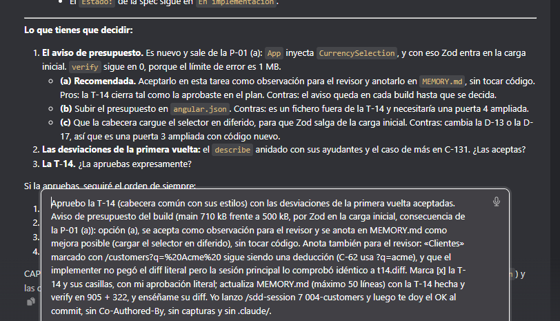

# 004-customers — Fase 7 (2026-11-25, sesión 06)

La sesión principal abrió este registro al recibir el retorno de la segunda vuelta de la T-14 (sin fase roja nueva: la de la primera vuelta consta en `sessions/2026-11-25-03-004-customers.md`); `/sdd-session` lo completa al cerrar la sesión.

## Objetivo y fase
- Fase 7, spec `004-customers`, puerta 5 (implementación). T-14 (cabecera común) retomada tras la T-16 (commit 64d4cba): cambios de la primera vuelta devueltos desde el scratchpad y comprobados; implementer Sonnet 5.5, encargo sin enseñar antes.
- Cierre de la T-14: aprobación, `[x]`, `MEMORY.md` y commit.
- La spec sigue en `En implementación`.

## Prompts clave
> OK al commit de la T-16 sin Co-Authored-By, con el mensaje que propones y los cinco ficheros que listas (customers-page.ts, customers-page.spec.ts, tasks.md, MEMORY.md y el registro 05), sin capturas y sin .claude/. Haz el git diff de cada fichero antes de commitear y confírmame el hash con git log -1. Después devuelve los cambios de la T-14 desde el scratchpad, compruébalos con diff, repite npm run verify y lanza al implementer de la T-14 (Sonnet 5.5) con las condiciones de siempre: rojo íntegro, git diff literal, sin tocar el índice, y parar si C-55 o C-56 siguen fallando.

> Apruebo la T-14 (cabecera común con sus estilos) con las desviaciones de la primera vuelta aceptadas. Aviso de presupuesto del build (main 710 kB frente a 500 kB, por Zod en la carga inicial, consecuencia de la P-01 (a)): opción (a), se acepta como observación para el revisor y se anota en MEMORY.md como mejora posible (cargar el selector en diferido), sin tocar código. Anota también para el revisor: «Clientes» marcado con /customers?q=%20Acme%20 sigue siendo una deducción (C-62 usa ?q=acme), y que el implementer no pegó el diff literal pero la sesión principal lo comprobó idéntico a t14.diff. Marca [x] la T-14 y sus casillas, con mi aprobación literal; actualiza MEMORY.md (máximo 50 líneas) con la T-14 hecha y verify en 905 + 322, y enséñame su diff. Yo lanzo /sdd-session 7 004-customers y luego te doy el OK al commit, sin Co-Authored-By, sin capturas y sin .claude/.

> /sdd-session 7 004-customers

> si, guárdalo e incluye la captura en el commit

## Qué propuso la IA
- El encargo de la segunda vuelta:
  - no reescribir la implementación;
  - comprobar casilla por casilla contra el árbol, con su evidencia;
  - parar si fallan C-55, C-56 o C-135;
  - investigar el aviso de presupuesto sin cambiar nada.
- Tres opciones para el aviso de presupuesto:
  - (a), recomendada: aceptarlo como observación para el revisor, sin tocar código;
  - (b): subir el presupuesto en `angular.json`;
  - (c): cargar el selector en diferido.
- En `tasks.md`, la aprobación literal limitada a las dos primeras frases del mensaje del autor.
- En `MEMORY.md`, quitar que la T-14 seguía en `[~]` con sus cambios apartados.

## Qué corregí y por qué
- (no registrado): el autor no corrigió ninguna propuesta. Lo corregido fue un error de la propia sesión principal: había dicho que C-56 y C-135 confirmaban la deducción sobre «Clientes» con `%20Acme%20`, y no la cubren. Lo señaló el implementer.

## Decisiones tomadas
- T-14 aprobada por el autor, con las desviaciones de la primera vuelta aceptadas: el `describe` anidado con sus ayudantes y un caso de más en C-131.
- Aviso de presupuesto (`main` 710 kB frente a 500 kB, por Zod en la carga inicial, consecuencia de la P-01 (a)): opción (a). Se acepta como observación para el revisor, sin tocar código. La mejora posible, cargar el selector en diferido, queda en `MEMORY.md`.
- Observaciones para el revisor: «Clientes» marcado con `%20Acme%20` sigue siendo una deducción (C-62 usa `?q=acme`). El implementer no pegó el `git diff` literal; la sesión principal lo comprobó idéntico a `t14.diff`.
- `npm run verify` en verde: 905 + 322.
- Commit de la T-14 sin `Co-Authored-By` y sin `.claude/`, con la captura `fase-7-004-t14-aviso-presupuesto.png` (decisión del autor al guardar este registro).
- Commit: el de cierre de esta sesión.

## Capturas
- 

## Pendiente para la siguiente sesión
- T-15 (seed de demostración) con `/sdd-implement 004-customers`. Después, la puerta 6 de la spec 004.

## Detalle y evidencia
### Cambios de la T-14 devueltos (sesión principal)
- Ninguno de los cuatro ficheros cambió en los commits posteriores a `6a696e7` (`git log 6a696e7..HEAD` vacío para ellos).
- Copiados desde `t14-apartado/` (scratchpad de la sesión 03): `app.html`, `app.ts`, `app.spec.ts` y `_shared.scss`; cada uno idéntico a su copia (`diff -q`), y `git diff` de los cuatro idéntico a `t14.diff` (`diff`).
- `NO_COLOR=1 FORCE_COLOR=0 npm run verify`: código 0; raíz `Tests  905 passed (905)`; web `Tests  322 passed (322)` (antes, 303). Aviso nuevo de `ng build`: `▲ [WARNING] bundle initial exceeded maximum budget. Budget 500.00 kB was not met by 219.99 kB with a total of 719.99 kB.` (`main` pasa de 270.18 kB a 709.99 kB). Salida literal en el encargo del implementer.
- `git status --short` justo antes y justo después de lanzar: solo los cuatro ficheros de la T-14.

### Retorno del implementer (segunda vuelta)
- `RESULTADO: Tarea terminada`. Ningún fichero cambiado en esta vuelta. C-55, C-56 y C-135 pasan; la regla de parada del riesgo 9 no se activa.
- Casillas, una a una, con su evidencia: C-47 (`app.spec.ts:77`, `:84`, `:88`, `:91`, `:92`); 19 tests nuevos en `describe('cabecera común (spec 004)')` (17 `it` y 2 casos de `it.each` en C-131); C-143 (solo tres líneas quitadas en `app.spec.ts`: el import ampliado, el título «dos enlaces» y `toHaveLength(2)`); C-66, C-67 y C-78 (`git diff --stat` vacío); C-65 (sin componente de cabecera).
- `npm run verify`: código 0, 905 + 322, con el mismo aviso de presupuesto.
- Causa del aviso, según el implementer: Zod entra en `main` por `app.ts` → `CurrencySelection` → `ExchangeRatesApi` → `exchange-rates.ts` (`import { z } from 'zod'`); consecuencia de la P-01 (a). Presupuesto en `apps/web/angular.json`: `maximumWarning` 500 kB y `maximumError` 1 MB.
- Desviaciones de la primera vuelta declaradas: `describe` anidado con sus ayudantes y un caso de más en C-131 (500 y esquema inválido, R-131).
- Para el revisor (del implementer): la deducción de «Clientes» marcado con `/customers?q=%20Acme%20` sigue sin probarse en la cabecera: C-62 usa `?q=acme`, y C-56 y C-135 no la cubren.
- No pegó el `git diff` literal (condición del autor): lo sacó la sesión principal (`t14-v2.diff` en el scratchpad), idéntico a `t14.diff`.

### Comprobaciones de la sesión principal
- `git status` y `git diff --stat`: solo los cuatro ficheros (422 inserciones y 11 borrados).
- `git diff` de los cuatro, idéntico a `t14.diff` (`diff`).
- Zod en el build: `grep -o ZodError` da 8 en `main-FWC6ROJO.js` y 0 en los ocho `chunk-*.js` de `apps/web/dist/web/browser`.
- `angular.json`: presupuesto `initial` con `maximumWarning` `500kB` y `maximumError` `1MB`.

### Opciones presentadas y elección del autor
- Aviso de presupuesto: (a) aceptarlo como observación para el revisor y anotarlo en `MEMORY.md`, sin tocar código (recomendada); (b) subir el presupuesto en `angular.json` (puerta 4 ampliada); (c) cargar el selector de la cabecera en diferido (puerta 3 ampliada). El autor eligió la (a) (prompt en «Prompts clave»).
- Corrección de la sesión principal en el mismo mensaje: había dicho que C-56 y C-135 confirmaban la deducción sobre «Clientes» con `%20Acme%20`; no la cubren (C-62 usa `?q=acme`).
- `tasks.md`: T-14 en `[x]` con sus ocho casillas, tres observaciones para el revisor y la aprobación literal del autor (las dos primeras frases de su mensaje).
- `MEMORY.md` actualizado (50 líneas).
