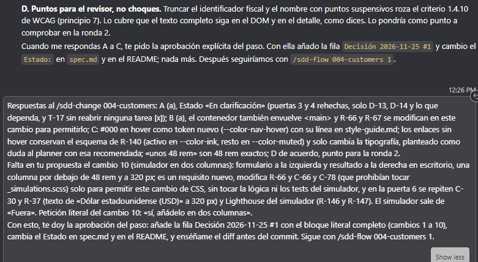
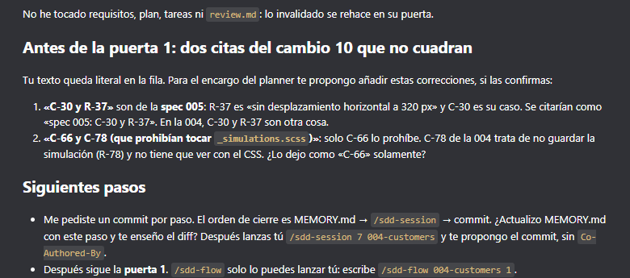

# 004-customers — Fase 7 (2026-11-25, sesión 08)

## Objetivo y fase
Fase 7, spec `004-customers`. Registrar con `/sdd-change` un cambio de requisitos, decidido por el autor después de la #24 y de la Q-13, que cubre todos los retoques visuales con sus casos de prueba, para que ningún CSS quede sin requisito (constitución, principio 1). La spec vuelve a `En clarificación` y este paso se commitea antes de seguir con la puerta 1.

## Prompts clave
Primer `/sdd-change`, sin argumentos: la IA pidió la spec y el cambio. Segundo `/sdd-change 004-customers`, sin el cambio: la IA pidió el cambio.

Cambio del autor (literal):
> Si el planner de la T-17 está lanzado, detenlo. Lanza /sdd-change 004-customers con este cambio de requisitos, decisión posterior del autor, que cubre TODOS los retoques visuales (con sus casos de prueba), de modo que ningún CSS quede sin requisito (constitución, principio 1).
>
> Petición del autor (literal): «Quiero todos estos cambios, en sdd-change». Sus decisiones del chat: «1, sí [ancho de 75 rem]; 2, b: quiero que sea fiel a la web cliente; 3, sí, y además quiero que sea un grid, mismo tamaño de tarjetas, ninguno más grande que otro; si el texto es demasiado grande aparecen puntos suspensivos» y «La cabecera quiero que tenga el fondo blanco asemejándose a la de Roams. font-weight: 600; font-size: 14px; line-height: 24; transition: 0.3s ease-out; con el hover font-weight: 700; font-size: 17px; color: #000».
>
> Cambios (requisitos nuevos o modificados, con su caso cada uno):
> 1. Contenedor común: ancho máximo de 75 rem (1200 px), centrado, con margen lateral; cabecera y <main>. Nuevo.
> 2. Cabecera con fondo blanco de borde a borde, sin logo ni migas, con el contenido en el contenedor: sustituye a R-141 y C-141. Sombra o línea inferior: duda para el planner con la recomendada de la guía.
> 3. Menú y selector de divisa alineados a la derecha, en una línea; etiqueta «Divisa» a la izquierda del control dentro de la cabecera; a 320 px puede apilarse. Modifica los requisitos de la cabecera afectados.
> 4. Enlaces del menú: font-weight 600, font-size 14px, line-height 24px, transition 0.3s ease-out; con hover font-weight 700, font-size 17px, color #000: sustituyen a R-139 y R-140. El mismo énfasis con :focus-visible; la transición se desactiva con prefers-reduced-motion. Criterio del enlace activo y tembleque por el cambio de tamaño en hover: dudas para el planner, en bloque, con recomendada.
> 5. Rejilla del buscador con todas las tarjetas del mismo tamaño (filas de la misma altura). Nuevo.
> 6. Tarjeta: nombre a 2 líneas y identificador fiscal a 1 línea, con puntos suspensivos si no caben; el texto completo sigue en el DOM y el nombre completo se ve en el detalle; sin desplazamiento horizontal (R-38). Nuevo, cruzado con R-38 y R-101.
> 7. Tarjeta como el boceto: nombre más pequeño y sin subrayado (subrayado solo con hover o foco); «Última simulación» en una fila con el importe a la derecha y línea separadora; eyebrow pegado al título. Nuevo.
> 8. Énfasis en las tarjetas con hover y :focus-within: borde de marca y fondo --color-soft, con tokens de la guía y sin quitar el contorno del navegador (R-68). Nuevo.
> 9. Detalle en dos columnas en escritorio («Datos» e «Historial») y una columna por debajo de unos 48 rem y a 320 px. Nuevo.
>
> Fuera: simulador y _simulations.scss (C-66, C-78), icono o logo, y «Estado de la API» solo en modo desarrollador (mejoras del README).
>
> Afecta además a: la nota de la Q-13 y la #24 de la sección 5 (anotar que las modifica una decisión posterior del autor), style-guide.md (línea «Menú», con mi autorización expresa solo para esa línea), y en el plan la D-13 y la D-14.
>
> Orden: spec.md primero, con el diff para mi aprobación; después una ronda del revisor limitada a lo cambiado (ADR-016); luego puertas 3 y 4 ampliadas con la T-17 (Sonnet 5.5, sin renumerar, después de la T-15 y antes de la puerta 6). Enséñame cada diff antes de pedir mi aprobación. Un commit por paso, con su /sdd-session, sin Co-Authored-By.

Respuestas y aprobación del autor (literal):
> Respuestas al /sdd-change 004-customers: A (a), Estado «En clarificación» (puertas 3 y 4 rehechas, solo D-13, D-14 y lo que dependa, y T-17 sin reabrir ninguna tarea [x]); B (a), el contenedor también envuelve <main> y R-66 y R-67 se modifican en este cambio para permitirlo; C: #000 en hover como token nuevo (--color-nav-hover) con su línea en style-guide.md; los enlaces sin hover conservan el esquema de R-140 (activo en --color-ink, resto en --color-muted) y solo cambia la tipografía, planteado como duda al planner con esa recomendada; «unos 48 rem» son 48 rem exactos; D de acuerdo, punto para la ronda 2.
> Falta en tu propuesta el cambio 10 (simulador en dos columnas): formulario a la izquierda y resultado a la derecha en escritorio, una columna por debajo de 48 rem y a 320 px; es un requisito nuevo, modifica R-66 y C-66 y C-78 (que prohibían tocar _simulations.scss) solo para permitir este cambio de CSS, sin tocar la lógica ni los tests del simulador, y en la puerta 6 se repiten C-30 y R-37 (texto de «Dólar estadounidense (USD)» a 320 px) y Lighthouse del simulador (R-146 y R-147). El simulador sale de «Fuera». Petición literal del cambio 10: «sí, añádelo en dos columnas».
> Con esto, te doy la aprobación del paso: añade la fila Decisión 2026-11-25 #1 con el bloque literal completo (cambios 1 a 10), cambia el Estado en spec.md y en el README, y enséñame el diff antes del commit. Sigue con /sdd-flow 004-customers 1.

Confirmación de las correcciones y del cierre (literal):
> Confirmo las dos correcciones para el encargo del planner (el literal de la fila de la decisión no se toca): «C-30 y R-37» del cambio 10 se citan como «spec 005: C-30 y R-37»; la prohibición de tocar _simulations.scss es solo C-66, y el planner revisa contra spec.md qué comprueba cada caso (C-66, C-67, C-78) y cita cada uno por lo que comprueba. Actualiza MEMORY.md (máximo 50 líneas) con este paso (decisión 2026-11-25 #1, Estado «En clarificación», cambios 1 a 10, respuestas A a D) y enséñame su diff. Las capturas fase-7-004-sdd-change-respuestas y sdd-change-cambio-10 las descarto: anótalo en una línea en el registro. Yo lanzo /sdd-session 7 004-customers y luego te doy el OK al commit, solo spec.md, README, MEMORY.md y el registro, sin Co-Authored-By. Después lanzaré /sdd-flow 004-customers 1.

Decisión sobre las capturas al guardar este registro (literal):
> Sí, guárdalo; enlaza las capturas y que entren en el commit

## Qué propuso la IA
- **Planner de la T-17:** no había ninguno lanzado en esta sesión. `ListAgents` mostró otras sesiones del autor, en reposo o esperando, que no se tocaron.
- **Lectura previa:** cargó `sdd` y leyó `reto.md` y `spec.md` («Estado: En implementación»; secciones 1 a 3, la 5 y la 6), además de la D-13 y la D-14 de `plan.md`, el estado de las tareas en `tasks.md` (las dieciséis en `[x]`) y las líneas «Menú», «Header», «Contenedor» y `.card` de `style-guide.md`. Comprobó que `<main>` no tiene ancho máximo y buscó el precedente de la sesión `2026-11-22-04` de la 000, donde el autor eligió «(b) En clarificación».
- **Propuesta en tabla:**
  - Lo invalidado. Requisitos: R-139, R-140 y R-141 sustituidos, R-55, R-101 y R-105 modificados, R-64 revisado y uno nuevo por cambio (desde R-171, los numera el planner). Casos: C-139 a C-141, C-55, C-64, C-101, C-105, C-38 y C-63. Además, las secciones 1, 3, 5 y 6 de la spec; la D-13, la D-14, la D-16 y las secciones 2, 5, 7 y 10 del plan; y la T-17 nueva, sin reabrir tareas `[x]`.
  - Primera puerta afectada: la 1.
  - Línea de decisión: `Decisión 2026-11-25 #1`.
- **Decisiones planteadas al autor:**
  - A: el `Estado:`, entre (a) `En clarificación` (recomendada, por el precedente) y (b) `Borrador`, con la nota de que en `sdd` «puerta ampliada» solo vale sin cambio de requisitos.
  - B: el cambio 1 choca con R-66 y R-67 de la propia spec, porque el contenedor de `<main>` cambia el simulador y «Estado de la API».
  - C: el `#000` frente a C-64 (tokens), el color de los enlaces sin hover y si «unos 48 rem» es un valor exacto.
  - D: el truncado frente al criterio 1.4.10, como punto para el revisor.
- **Tras la aprobación:** antes de escribir, comprobó las citas del cambio 10. «C-30 y R-37» son de la spec 005, y C-78 de la 004 trata de no guardar la simulación, no de `_simulations.scss`. Guardó el literal sin tocarlo y planteó las dos correcciones para el encargo del planner. Añadió la fila `2026-11-25 #1` en `spec.md:861` y cambió el `Estado:` en `spec.md:3` y en el README, y enseñó el diff.
- **MEMORY.md:** actualizó la línea 49 con el paso (sigue en 50 líneas) y enseñó el diff.
- **Capturas:** al preparar este registro vio que las dos anunciadas existían en `ai-workspace/screenshots/` (sin seguimiento en git), aunque el autor las había descartado, y le preguntó qué hacer.

## Qué corregí y por qué
- La propuesta de la IA no incluía el cambio 10 (simulador en dos columnas). El autor lo añadió y, con él, la modificación de R-66 y C-66, que el simulador salga de «Fuera» y que en la puerta 6 se repitan las comprobaciones a 320 px y Lighthouse del simulador.
- Confirmó las dos correcciones de las citas para el encargo del planner, sin tocar el literal de la fila, y pidió que el planner cite C-66, C-67 y C-78 por lo que comprueba cada uno.
- Las capturas que había descartado se enlazan y entran en el commit: ya existían.

## Decisiones tomadas
- `Decisión 2026-11-25 #1`, en la sección 5 de `spec.md`, con el texto literal del cambio y de las respuestas.
- Respuestas del autor:
  - A (a): `En clarificación`, puertas 3 y 4 rehechas y T-17.
  - B (a): el contenedor envuelve `<main>`, y R-66 y R-67 se modifican.
  - C: token `--color-nav-hover`; los enlaces sin hover, con el esquema de R-140, como duda con esa recomendada; 48 rem exactos.
  - D: punto para la ronda 2.
  - Más el cambio 10.
- `Estado:` de la spec 004 y su fila en el README: de `En implementación` a `En clarificación`.
- Para el encargo del planner: «spec 005: C-30 y R-37», y la prohibición de tocar `_simulations.scss` es solo de C-66.
- Las dos capturas se enlazan y entran en el commit.
- Commit: el de cierre de esta sesión.

## Capturas

## Pendiente para la siguiente sesión
- El autor lanza `/sdd-flow 004-customers 1`. El planner rehace `spec.md` con los cambios 1 a 10 y añade las dudas nuevas: sombra o línea, enlace activo y tembleque, y colores sin hover. El encargo lleva las dos correcciones de las citas.
- Después, la ronda del revisor limitada a lo cambiado (puerta 2), con el punto D. Luego las puertas 3 y 4 rehechas (D-13, D-14, `style-guide.md` líneas «Menú» y token, y T-17 con Sonnet 5.5) y la puerta 5 con la T-17. Un commit por paso.
