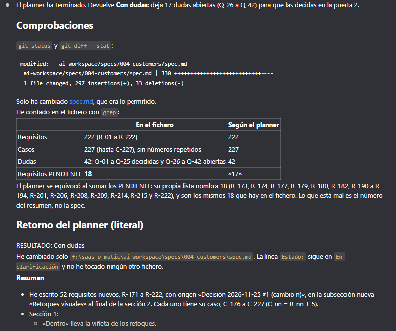
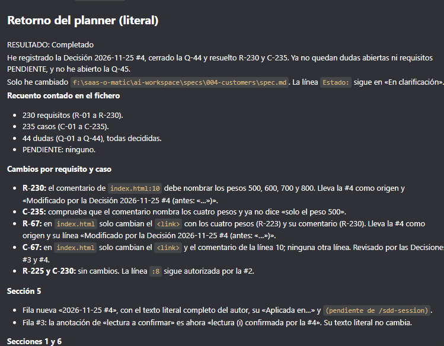

# 004-customers — Fase 7 (2026-11-25, sesión 09)

## Objetivo y fase
Fase 7, spec `004-customers`. Rehacer las puertas 1 y 2 tras el cambio de requisitos de la sesión 08 (Decisión 2026-11-25 #1: retoques visuales con sus casos). La puerta 1 pasa los cambios 1 a 10 a requisitos y casos. La puerta 2 decide las dudas nuevas, recoge una ronda del revisor limitada a lo cambiado y termina con la aprobación del autor. Las dos puertas van en un solo commit.

## Prompts clave
Arranque: `/sdd-flow 004-customers 1`.

Aprobación del encargo de la puerta 1 (literal):
> Aprobado el encargo de la puerta 1 rehecha, con dos retoques antes de lanzarlo al planner (Opus 5.5): (1) pega dentro del encargo, completo y literal, el bloque de la Decisión 2026-11-25 #1 de spec.md (los cambios 1 a 10 y mis respuestas A a D), no solo la referencia al fichero; (2) en «Qué se pide», añade la lista cerrada de la propuesta aprobada: sustituidos R-139, R-140, R-141 y C-139 a C-141; modificados R-55, R-66, R-67, R-101 y R-105; revisados R-64, C-38, C-55, C-63, C-64, C-101 y C-105, y C-66 solo para permitir el CSS de dos columnas del simulador. Antes de enseñarme el retorno, cuenta en spec.md requisitos, casos y dudas (Q) y dame esos números junto al retorno, y comprueba con git diff que solo cambió spec.md.

Aprobación de la puerta 1 y respuestas de la puerta 2 (literal):
> Apruebo la puerta 1 rehecha de la 004-customers. Corrige el resumen: son 18 requisitos PENDIENTE (R-173, R-174, R-177, R-179, R-180, R-182, R-190 a R-194, R-201, R-206, R-208, R-209, R-214, R-215 y R-222), no 17.
> Puerta 2, mis respuestas literales a las dudas: Q-26 (a); Q-27 (a) (si hay una opción que además ponga peso 700 al activo, esa); Q-28 (a); Q-29 (a); Q-30 (a); Q-31 (a); Q-32 (a); Q-33 (a); Q-34 (a); Q-35 (a), y autorizo tocar index.html (cargar el peso 600 de Montserrat) y dos líneas de style-guide.md; Q-36 (a); Q-37 (a); Q-38 (a); Q-39 (a); Q-40 (a); Q-41 (a); Q-42 (a). Confirmo las tres lecturas del planner (los 48 rem y el umbral de la cabecera sobre el ancho de la ventana; la línea separadora de la tarjeta encima de la fila y en --color-bg; R-213, el énfasis no cambia el tamaño de la tarjeta).
> Hallazgos 1 a 5 del planner: se resuelven en esta puerta 2, no en otra vuelta de la puerta 1: corrige tú, en la vuelta del planner de la puerta 2, el 1 (C-67), el 3 (nota de la #26 sobre el contenedor) y el 5 («Aplicada en…» de la fila 2026-11-25 #1); amplía R-38 y C-38 a «Estado de la API» y al simulador a 320 px, con su caso (hallazgo 2); y añade index.html a la lista de R-67 por la Q-35 (hallazgo 4).
> Registra mis respuestas literales en la sección 5 de spec.md (Decisión 2026-11-25 #2). Después, una sola ronda del revisor limitada a lo cambiado (ADR-016): enséñame su encargo antes de lanzarlo y su veredicto literal, con los recuentos del fichero, sin guardarlo ni cambiar el Estado hasta mi OK. Antes de enseñarme cualquier retorno, cuenta en spec.md requisitos, casos y dudas y dame los números. Las puertas 1 y 2 van en la misma sesión y el mismo commit, con /sdd-session 7 004-customers, sin Co-Authored-By.

Tras cortarse el agente (literal):
> el agente se a cerrado, que sigua

Q-43 (literal):
> Q-43: elijo la (c) con una corrección: cargar los pesos 500, 600, 700 y 800 de Montserrat (sin el 400, que la web no usa: el cuerpo es 500, y los títulos son 800), y amplío la autorización a index.html (el <link>) y a las líneas :17 y :48 de style-guide.md para que digan «500, 600, 700 y 800», sin tocar nada más de la guía. Relanza al planner (Opus 5.5, encargo sin enseñar) para que registre la Decisión 2026-11-25 #3 con este texto literal, resuelva R-228 y C-233 (peso 800 incluido) y anote en R-223, R-224 y R-225 los pesos finales. Que no decida ningún hueco. Después cuenta en spec.md requisitos, casos y Q (debe quedar 0 PENDIENTE y 0 Q abiertas), comprueba con git diff que solo cambió spec.md y enséñame el retorno, y luego el encargo del revisor (ronda única limitada a lo cambiado, con el punto D del truncado frente al criterio 1.4.10) antes de lanzarlo.

Línea `:8`, Q-44 y regla del autor (literal):
> Respuestas: línea :8 de style-guide.md, lectura (i): sigue autorizada por la #2 (R-225 y C-230 se mantienen), y mi #3 solo añade la :48; Q-44, opción (a): actualizar el comentario de index.html:10 para que nombre los cuatro pesos, como parte del cambio del <link>. Relanza al planner para que registre la Decisión 2026-11-25 #4 con este texto literal y resuelva R-230 y C-235.
> Regla del autor desde ahora, para evitar más vueltas: si al aplicar una decisión mía queda solo una consecuencia directa en un comentario o en un texto de documentación de un fichero que la decisión ya autoriza tocar, se aplica y se anota en «Aplicada en…» y en la nota de la sección 1, sin abrir una duda Q-nn. Las dudas son solo para huecos reales del reto o de requisitos, y para valores que yo no haya dado. El planner no abre más dudas por comentarios. Después cuenta en spec.md requisitos, casos y Q (debe quedar 0 PENDIENTE y 0 Q abiertas), comprueba con git diff que solo cambió spec.md y enséñame el retorno; luego el encargo del revisor (ronda única limitada a lo cambiado, con el punto D del truncado frente al criterio 1.4.10, y con la comprobación de que style-guide.md solo cambia en «Menú» y en las líneas :8, :17 y :48, e index.html solo en el <link> y su comentario). La captura fase-7-004-p2-encargo-linea-8 la descarto; la de la Q-43 también.

Aprobación del encargo del revisor (literal):
> Apruebo el encargo del revisor (ronda 3 de la puerta 2, Opus, effort High) con tres retoques: (1) añade la línea de reservas ya aceptadas por el autor, que no son hallazgo: H-04, H-10, H-14 (requisitos compuestos), H-15 y H-21 (numeración de los casos) de esta spec; H-13 y H-14 de la 002; H-13 a H-15 de la 003; y H-05 y H-24 de la 005 en lo que deciden Q-15 y Q-16; (2) pide el «Seguimiento de la ronda anterior»: H-18 a H-21 de la ronda 2 y las reservas abiertas H-04, H-10, H-14 y H-15; (3) corrige la línea del Estado («Estado: En clarificación», sin el resto de formato). Si el revisor no puede leer el diff del scratchpad, que lo diga y se apoye en Grep de «Modificado por la Decisión 2026-11-25» y «Decisión 2026-11-25 #1». Lánzalo y enséñame el veredicto literal, con los recuentos del fichero (230, 235 y 44), sin guardarlo ni cambiar el Estado hasta mi OK.

Decisiones sobre la ronda 3 (literal):
> Guarda la ronda 3 en review.md como «## Ronda 3», con los signos reales (<, >, LoadState<T>) y las tablas completas; el Estado sigue en «En clarificación» hasta mi aprobación.
> Mis decisiones sobre H-22 a H-32:
> - El planner corrige, en una vuelta corta y sin abrir dudas Q-nn (regla del autor), H-22, H-23, H-24, H-25 y H-26, y H-27 (R-66, R-220 y C-66 deben permitir también R-222 y R-226 en el simulador, solo CSS).
> - H-28: opción (a): por debajo de 48 rem, el menú se parte en dos líneas (flex-wrap), alineado a la derecha, y el selector de divisa debajo; requisito y caso nuevos, sin que desborde a 320 px (R-38).
> - H-30: requisito y caso nuevos: la fila «Identificador fiscal» del detalle lo muestra entero, sin recortar, partiéndolo en líneas si hace falta.
> - H-31: un caso manual para la puerta 6 de WCAG 1.4.4 (texto al 200 %) y otro de 1.4.12 (espaciado del texto), sin automatizar.
> - H-32: C-226 se redacta con resultado: con base-select, el texto «Dólar estadounidense (USD)» se ve entero a 320 px y aprueba; sin base-select aplica la limitación aceptada P-08 (a) de la 005 y no cuenta como fallo.
> - H-29: reserva aceptada, con este motivo: no se puede medir en la spec si a 768 px caben los enlaces con el ancho reservado; se mide en la puerta 6, y si no caben, la cabecera se parte en dos líneas (H-28 (a)), sin cambio de requisitos.
> - Reservas aceptadas que se quedan abiertas: H-04, H-10, H-14, H-15, H-21 y H-29, cada una con su motivo.
> Relanza al planner con esto; registra mis decisiones como Decisión 2026-11-25 #5 con mi texto literal; después cuenta en spec.md requisitos, casos y Q (0 PENDIENTE y 0 Q abiertas), comprueba con git diff que solo cambió spec.md y enséñame el diff antes de pedirme la aprobación de la puerta 2. Sin otra ronda del revisor (ADR-016, punto 1). La captura fase-7-004-p2-ronda3-veredicto la descarto.

H-29 y primera aprobación condicionada (literal):
> H-29: opción (a). Relanza al planner (Opus 5.5, encargo sin enseñar) en una vuelta corta: R-179 y R-231 permiten que, desde 48 rem, los enlaces del <nav> se partan en dos líneas si no caben (flex-wrap, alineados a la derecha, con el selector de divisa a su derecha), sin desplazamiento horizontal, y C-184 lo comprueba a 768 px exactos; registra mis palabras literales como Decisión 2026-11-25 #6, con la nota de que cumple el motivo aceptado de H-29 («si no caben, la cabecera se parte en dos líneas, sin cambio de requisitos»); H-29 queda como reserva abierta con ese motivo. Sin dudas Q-nn nuevas (regla del autor).
> Borra la captura «fase-7-004-p2-ronda3-veredicto.png .png» (la descarté); no la toques de otra forma.
> Aprobación de la puerta 2, condicionada: si, tras esa vuelta, el diff solo toca R-179, R-231, C-184 y las filas y notas de la #6 y de H-29, y spec.md queda con 0 PENDIENTE, 0 Q abiertas y los recuentos que den el fichero, apruebo la puerta 2 de la 004-customers, con las reservas H-04, H-10, H-14, H-15, H-21 y H-29, cada una con su motivo. Enséñame igualmente el diff y los recuentos. Si el diff toca algo más, no apruebes y avísame. Con eso: Estado «Aprobada» en spec.md y en el README, sección «Aprobación del autor» en review.md con mis palabras literales, MEMORY.md al día (máximo 50 líneas) con las reservas como pendientes y su diff, y yo lanzo /sdd-session 7 004-customers y te doy el OK al commit único de las puertas 1 y 2 rehechas, sin Co-Authored-By, sin capturas y sin .claude/.

Consecuencias directas y segunda condición (literal):
> ## Decisiones
> 1. H-29 / #6: opción (a), consecuencias directas. Se aplican a la sección 3, a R-55 y a C-55: desde 48 rem, el selector de divisa va a la derecha del <nav>, en la línea de su último enlace si el <nav> ocupa dos. Los valores concretos los redacta el planner, sin decisión nueva mía.
> 2. Aprobación de la puerta 2, condicionada (sustituye a la anterior): si el diff acumulado de las vueltas #5 y #6 solo toca R-179, R-231, C-184, R-55, C-55, la sección 3 y las filas y notas de la #6 y de H-29, y spec.md queda con 0 PENDIENTE, 0 Q abiertas y los recuentos que den el fichero, apruebo la puerta 2 de la 004-customers con las reservas H-04, H-10, H-14, H-15, H-21 y H-29, cada una con su motivo. Si toca algo más, no apruebes y avísame.
>
> ## Acciones (en orden)
> 1. Relanza al planner (Opus 5.5, encargo sin enseñar) en una vuelta mínima: sección 3, R-55 y C-55, y la revisión, en la misma pasada, de todo lo que cite R-179 o diga «una línea» o «48 rem» (R-180, R-181, R-231, C-184, C-185, C-186, C-236 y las secciones 1 y 3). Sin dudas Q-nn nuevas (regla del autor): lo que sea consecuencia directa se aplica y se anota.
> 2. Cuenta en spec.md requisitos, casos y Q; comprueba con git diff que solo cambió spec.md y enséñame el diff y los recuentos.
> 3. Si se cumple la condición: Estado «Aprobada» en spec.md y en el README; sección «Aprobación del autor» en review.md con mis palabras literales; MEMORY.md al día (máximo 50 líneas) con las reservas como pendientes; enséñame su diff.
> 4. Yo lanzo /sdd-session 7 004-customers y te doy el OK al commit único de las puertas 1 y 2 rehechas.
>
> ## Límites
> - Solo spec.md, review.md, el README y MEMORY.md; nada de plan.md, tasks.md ni código.
> - Sin Co-Authored-By, sin capturas y sin .claude/.

Aprobación final (literal):
> ## Decisiones
> 1. El paréntesis añadido en spec.md:19 cuenta como nota de la Decisión 2026-11-25 #6 (consecuencia directa): la condición de mi aprobación se cumple.
> 2. Apruebo la puerta 2 de la 004-customers, con las reservas H-04, H-10, H-14, H-15, H-21 y H-29, cada una con su motivo (los de review.md; el de H-29: se mide en la puerta 6, y si los enlaces no caben se parten en dos líneas por la Decisión 2026-11-25 #6, sin cambio de requisitos).
>
> ## Acciones (en orden)
> 1. Estado «Aprobada» en spec.md y en la fila 004 del README.
> 2. Sección «Aprobación del autor» al final de review.md, con mis palabras literales de la condición y de esta decisión.
> 3. MEMORY.md al día (máximo 50 líneas) con las reservas como pendientes; enséñame su diff.
> 4. Yo lanzo /sdd-session 7 004-customers y te doy el OK al commit único de las puertas 1 y 2 rehechas.
>
> ## Límites
> - Solo spec.md, review.md, el README y MEMORY.md; sin plan.md, tasks.md ni código.
> - Sin Co-Authored-By, sin capturas y sin .claude/.
> - Las capturas p2-completada y p2-respuestas-q26-q42 no entran en el commit (descartadas).

Capturas al cerrar la sesión (literal):
> añade las que existen, las dems descartalas

## Qué propuso la IA
- **Puerta 1:**
  - Leyó el `Estado:` («En clarificación»), la fila 2026-11-25 #1 y el registro de la sesión 08. Montó el encargo del planner con las dos correcciones de las citas y las dudas que había que abrir, y lo enseñó antes de lanzarlo.
  - Planner con Opus 5.5. Al volver dio `Con dudas`: R-171 a R-222 y C-176 a C-227, y Q-26 a Q-42. La IA contó en el fichero 222 requisitos, 227 casos, 42 Q y **18** PENDIENTE; el planner había escrito 17 y su propia lista nombraba 18. Pasó también los cinco posibles hallazgos del planner fuera de la lista cerrada.
- **Puerta 2:**
  - **Q-27:** leyó la condición del autor como la opción (b) («peso 700 fijo, sin cambiar de tamaño») y se lo dijo antes de seguir.
  - **Vuelta cortada:** la sesión se cerró con el planner a medias. La IA miró el trabajo parcial con `git diff --stat` (17 de los 18 PENDIENTE resueltos, Q sin pasar a «Decidida») y reanudó al mismo agente para que terminara sin rehacer.
  - **Q-43:** el planner la abrió porque `index.html:11` solo cargaba el peso 500. La IA lo comprobó en `index.html:10-11` y en `style-guide.md:8`, `:17` y `:48` antes de enseñarlo, y recomendó la (a).
  - **Línea `:8`:** en el encargo de la Q-43 la IA añadió «y la :8 del ajuste 3, si R-225 ya la cubría por la #2», que no estaba en las palabras del autor. El planner lo señaló, y la IA reconoció el fallo y planteó las lecturas (i) y (ii).
  - **Q-44:** el comentario de `index.html:10`. La IA recomendó la (a) y guardó la regla del autor en su memoria local.
  - **Ronda 3:** guardó en el scratchpad el diff de `spec.md` frente a `HEAD` para el revisor, que no tiene Bash, y enseñó el encargo. Revisor con Opus y effort High: `Conforme con reservas`, H-22 a H-32 Menores. La IA comprobó H-22 y H-27 en el fichero y clasificó los hallazgos en correcciones, decisiones del autor y riesgo no medible.
  - **Guardado de la ronda 3:** al final de `review.md`, desde un fichero del scratchpad, con los signos reales.
  - **Comprobación del diff:** sacó el diff de cada vuelta contra copias previas de `spec.md` (`prev5.md` y `prev6.md`) y las enseñó antes de cada aprobación.
  - **Choque de H-29:** el motivo del autor chocaba con R-179 («una sola línea» desde 48 rem). La IA lo comprobó y planteó (a), (b) y (c), con (a) recomendada.
  - **Primera condición:** se cumplía, pero la IA paró porque el planner señaló R-55, C-55 y la sección 3 como incoherentes con la #6.
  - **Segunda condición:** paró de nuevo por el paréntesis de `spec.md:19` («Dentro»), que no estaba en la lista literal.
  - **Ambigüedad de la condición:** avisó de que «el diff acumulado de las vueltas #5 y #6» no podía leerse al pie de la letra, porque la #5 tocó mucho más.
- **Tras la aprobación:**
  - `Estado: Aprobada` en `spec.md` y en el README.
  - «Aprobación del autor (ronda 3, 2026-11-25)» al final de `review.md`, sin tocar la de la ronda 2.
  - MEMORY.md al día, con 50 líneas, y su diff.

## Qué corregí y por qué
- **El encargo de la puerta 1:** pegar el bloque literal completo de la #1, no solo la referencia, y añadir la lista cerrada de sustituidos, modificados y revisados.
- **El recuento del planner:** 18 PENDIENTE, no 17.
- **Q-35 y Q-43:** la (c) corregida, con los pesos 500, 600, 700 y 800 sin el 400.
- **La línea `:8`:** que se colara en el encargo era fallo de la IA. El autor eligió la lectura (i) e impuso la regla de no abrir Q-nn por comentarios ni textos de documentación ya autorizados.
- **El encargo del revisor:**
  - la línea de reservas ya aceptadas;
  - el «Seguimiento de la ronda anterior»;
  - la línea `Estado:` sin formato.
- **H-29:** el motivo se hizo cumplir con la #6 en lugar de dejar el choque con R-179.
- **La condición:**
  - se rehízo para incluir R-55, C-55 y la sección 3;
  - el paréntesis de `:19` cuenta como nota de la #6.
- **Capturas:** al cerrar, las dos que existen se añaden y las demás se descartan.

## Decisiones tomadas
- **Decisiones 2026-11-25 #2 a #6** en la sección 5 de `spec.md`, con el texto literal del autor:
  - #2, Q-26 a Q-42 (Q-27 en (b)) y hallazgos 1 a 5 del planner;
  - #3, Q-43;
  - #4, lectura (i) de la `:8`, Q-44 (a) y regla del autor;
  - #5, H-22 a H-32;
  - #6, H-29 (a).
  - Consecuencias directas de la #6 en R-55, C-55, la sección 3 y la sección 1, por la regla de la #4.
- **Resultado:** 232 requisitos, 239 casos y Q-01 a Q-44 decididas, con 0 PENDIENTE.
- **Ronda 3 del revisor** guardada en `review.md`: `Conforme con reservas`.
- **Puerta 2 aprobada:** `Estado:` pasa de `En clarificación` a `Aprobada` en `spec.md` y en el README.
- **Reservas pendientes:** H-04, H-10, H-14, H-15, H-21 y H-29, cada una con su motivo.
- **Capturas descartadas:** `fase-7-004-p1-rehecha-dudas-q26-q42`, `fase-7-004-p2-q43-pesos-montserrat`, `fase-7-004-p2-encargo-linea-8` y `fase-7-004-p2-ronda3-veredicto`. El fichero `… .png .png` lo borró la IA con OK del autor.
- **Commit:** el de cierre de esta sesión.

## Capturas

Anunciadas y no existentes, descartadas por el autor: `fase-7-004-p1-rehecha-dudas-q26-q42.png` (la propuso el planner), `fase-7-004-p2-q43-pesos-montserrat.png`, `fase-7-004-p2-encargo-linea-8.png` y `fase-7-004-p2-ronda3-veredicto.png`.

## Pendiente para la siguiente sesión
- Sustituir, con OK del autor, las seis celdas `(pendiente de /sdd-session)` de las filas 2026-11-25 #1 a #6 por la ruta de este registro. Después, el commit único de las puertas 1 y 2 rehechas.
- **Puerta 3 ampliada:** D-13, D-14 y lo que dependa de ellas. **Puerta 4 ampliada:** T-17 con Sonnet 5.5, sin reabrir tareas `[x]`. **Puerta 5:** la T-17. Un commit por paso.
- **Puerta 6:**
  - C-238 y C-239 a mano (WCAG 1.4.4 y 1.4.12);
  - medir H-29 a 768 px;
  - C-226 con y sin `base-select`.
