# 004-customers — Fase 7 (2026-11-25, sesión 15)

## Objetivo y fase
Fase 7, spec `004-customers`, puerta 6 (validación), en `En revisión` desde `1e08acd`. En esta sesión:
- Lighthouse y las vistas finales.
- Las pruebas del autor en Firefox.
- El encargo del revisor y su ronda 4 (`Conforme con reservas`).
- Las medidas de H-33, H-34 y H-39 en Chrome.
- La tercera corrección del autor sobre la T-18 (R-196, R-204, R-206), que cierra H-33 (commit `9530787`).
- La ronda 5 del revisor (`Conforme con reservas`), C-238 con el CSS final en Firefox y el cierre de la spec: `Estado: Cerrada`.

## Prompts clave
> OK al commit, hazlo y sigue con Lighthouse

> Mis pruebas en Firefox están hechas y las capturas están en ai-workspace/screenshots: fase-7-004-p6-c238-firefox-escritorio, -media y -movil (C-238 al 200 %), fase-7-004-p6-firefox-buscador-320 y fase-7-004-p6-firefox-cabecera-usd-320 (sin base-select, el selector corta «Dólar estadounidense (US…» a 320 px: limitación aceptada de la 005, P-08 (a)). C-226 del simulador: <ya la tengo / la comprobé con el mismo componente en la cabecera>. Añade las capturas al registro 15 y sigue con el encargo del revisor, que me enseñas antes de lanzarlo.

> (c) Hecha: la captura es fase-7-004-p6-c226-firefox-simulador-320. Firefox sin base-select, simulador a 320 px con USD: sin barra horizontal y con el corte de «Dólar estadounide…» en el control cerrado de Divisa, que es la limitación aceptada de la 005 (P-08 (a)). Pon esa línea en el encargo, añade también fase-7-004-p6-cabecera-usd-900 (evidencia de H-29) y las demás capturas al registro 15, y lanza al revisor tal cual. Cuando devuelva la ronda, enséñamela antes de guardarla en review.md.

> ## Decisiones
> 1. OK a guardar la ronda 4 en review.md con los signos reales (<, >) en lugar de &lt; y &gt;; anótalo en el registro.
> 2. H-33, H-34 y H-39: mide, sin tocar código.
> 3. H-35: corrígelo en el commit de cierre (tasks.md:14, «Estado de las tareas»), como consecuencia directa de documentación (regla de la Decisión 2026-11-25 #4).
> 4. Acepto como reservas Menor, cada una con su motivo:
>    - H-36: cada comentario nombra su spec en «spec 004:», así que no hay ambigüedad; acepto la lectura de R-144 «calificada una vez por comentario».
>    - H-37: el plan aprobado (D-14, D-17 y riesgo 14) fija esos valores y manda sobre la casilla de la checklist.
>    - H-38: la sección 1 de spec.md no anota los ajustes del ADR-016 de las puertas 3 a 5, como H-14, H-15, H-16 y H-17 de las otras specs; va a la pasada única de reservas.
> 5. H-39: mis capturas de Firefox del 200 % (fase-7-004-p6-c238-firefox-*) son de las 16:25, con el importe centrado, es decir, con el CSS de 1e08acd. Cuentan para C-238. Falta C-239 con el CSS final.
>
> ## Acciones
> 1. H-33: mide, en Chrome, la posición de la línea separadora (`border-top` de `.customer-card__last`) por fila de la rejilla a 768, 1024 y 1280 px, con la base del seed. Dime si se alinean; si no, para y pregúntame (salida: corregir con `flex-direction: column` o extender a R-206 mi reserva de R-204).
> 2. H-34: en Chrome, Intro sobre el nombre de una tarjeta (abre el detalle), Tab por el campo de búsqueda, el selector de divisa, «Volver a Clientes» e «Ir al simulador», activando cada uno; y el contorno de foco del enlace de la tarjeta sobre el fondo suave. Yo hago Tab en Firefox.
> 3. H-39: repite C-239 (hoja de 1.4.12) a 320, 768 y 1280 px en buscador y detalle con el CSS final.
> 4. Enséñame los resultados antes de lanzar ninguna ronda nueva.
>
> ## Límites
> - Sin tocar apps/ ni la spec.
> - Captura del veredicto: la hago yo, con el nombre fase-7-004-p6-ronda-4-revisor.

> ## Decisiones
> 1. Elijo (a): tercera corrección del autor sobre la T-18, sin cambio de requisitos (R-196, R-204, R-206), solo en `_customers.scss`: `.customer-card__last` con `flex-direction: column` y `align-items: center` (sin `flex-wrap`), manteniendo `gap`, `border-top`, `padding-top` y `margin: auto 0 0`; `.customer-card__amount` como está. Si necesitas otra regla mínima para que quede centrado, dímelo antes de añadirla.
> 2. La desviación D1 de R-204 («misma fila») queda aplicada literalmente en todos los anchos; la D2 (importe centrado) sigue igual. Mismos motivos literales.
> 3. H-33 se cierra por corrección, no por reserva.
>
> ## Acciones
> 1. Aplica, enséñame el `git diff` literal y mide: línea separadora por fila de la rejilla a 320, 360, 768, 1024, 1280 y 1600 px (con el seed y los clientes largos), altura de las tarjetas (R-196), desplazamiento horizontal, y que el texto no se parte ni se solapa. Repite C-239 con el CSS final a 320, 768 y 1280.
> 2. `npm run verify` (913 + 324).
> 3. Con mi OK: `MEMORY.md` (50 líneas), `tasks.md`, registro 15 y su diff; lanzo /sdd-session; propones el commit aparte, «tercera corrección del autor sobre la T-18 (R-196, R-204, R-206)».
> 4. Después, ronda 5 del revisor limitada a H-33, H-34 y H-39, con el encargo enseñado antes de lanzarlo.
>
> ## Límites
> - Solo `_customers.scss`. Nada más de `apps/` ni de la spec.
> - Sin captura de esta decisión. Sin Co-Authored-By.

> OK al diff, renombra la captura y sigue con MEMORY.md

> OK al diff de MEMORY.md y de tasks.md. Las dos preguntas pendientes: `justify-content` queda fuera; y sí, repito yo C-238 en Firefox con el CSS final (fase-7-004-p6-c238-firefox-final-escritorio, -media y -movil) y te aviso cuando las tenga, para añadirlas al registro 15. Lanzo yo /sdd-session 7 004-customers; después propón el commit «tercera corrección del autor sobre la T-18 (R-196, R-204, R-206)», con review.md (ronda 4), tasks.md, MEMORY.md, _customers.scss, el registro 15 y las capturas ya hechas, sin Co-Authored-By. Las tres capturas de Firefox finales entrarán en el commit de cierre.

> Hago el commit sin las capturas finales de C-238 en Firefox. Anótalo en el registro 15 y en la ronda 5 así: «C-238 con el CSS final (fila en columna): sin captura de Firefox; cubierto por la medida de Chrome text-spacing-column.json y por las tres capturas de Firefox anteriores (fase-7-004-p6-c238-firefox-escritorio, -media y -movil, hechas con el CSS de 1e08acd)». Si saco la captura después, entrará en el commit de cierre.

> sí, prepara el encargo de la ronda 5 con esa línea

> Sí, prepara el encargo de la ronda 5, limitada a H-33, H-34 y H-39, y enséñamelo antes de lanzarlo. Corrige la nota sobre C-238: text-spacing-column.json mide C-239, no C-238. Pon en el encargo, literal: «C-238 (texto al 200 %) con el CSS final (fila en columna): sin captura de Firefox. Lo que sí hay con el CSS final: C-239 (espaciado 1.4.12) medido en Chrome en text-spacing-column.json, y la medida de las separadoras y de la altura de las tarjetas (h33-final.json). Las tres capturas de Firefox del 200 % (fase-7-004-p6-c238-firefox-escritorio, -media y -movil) son del CSS de 1e08acd, con la fila ya en dos líneas a esos anchos.» Pasa a la ronda 5 el diff de la tercera corrección, la salida literal de npm run verify y los JSON de medida nuevos. La nota del registro 15 entra en el commit de cierre.

> Hecho en Firefox: Tab recorre los tres enlaces del menú, el selector de divisa, el campo de búsqueda y el nombre de una tarjeta, con el contorno de foco entero en todos (también sobre el fondo suave de la tarjeta); Intro sobre el nombre abre el detalle. Pon eso literal en el encargo, en H-34, y lánzalo.

> ## Decisiones
> 1. OK a guardar la ronda 5 en review.md con los signos reales (<, >); anótalo en el registro.
> 2. H-40: elijo (b), lo acepto como reserva. Motivo literal mío: «La tercera corrección la decidí yo, de forma visible, como corrección del autor sobre la T-18, igual que las dos anteriores. No cambia código ni tests respecto a lo medido, y el rastro está en tasks.md (T-18), MEMORY.md y los registros 13 a 15, con su medida. Regularizarlo con una puerta 4 ampliada y otra ronda costaría unos 45 minutos de papeleo sin mejorar el software. Acepto que no sigue SKILL.md:42.» Añade a «Aprendizajes» de MEMORY.md: «Tras Conforme con reservas en la puerta 6, corregir una reserva obliga a pasar por puerta 4 ampliada (SKILL.md:42); en la 004 se hizo como corrección del autor y quedó como reserva H-40; revisar SKILL.md después de la entrega.»
> 3. H-41: elijo (a). Repetí C-238 en Firefox con el CSS final: capturas fase-7-004-p6-c238-firefox-final-escritorio y fase-7-004-p6-c238-firefox-final-movil. Resultado: <la fila va en dos líneas y se ve entera / no hay desplazamiento horizontal / el corte izquierdo de la captura anterior era un recorte de la captura>. Cuéntalo así en el registro y sustituye mi frase «con la fila ya en dos líneas a esos anchos» por: «solo fase-7-004-p6-c238-firefox-media muestra la fila en dos líneas; -movil y -escritorio, hechas con el CSS de 1e08acd, la muestran en una».
>
> ## Acciones
> 1. Guarda la ronda 5; corrige H-35 (tasks.md:14); actualiza MEMORY.md (50 líneas) y enséñame el diff; con mi OK, lanzo /sdd-session y propones el commit de cierre.
> 2. La aprobación literal de cierre nombrará cada reserva con su motivo; te la enseño antes.
>
> ## Límites
> - Sin ronda 6. Sin tocar apps/ ni .claude/.

> Las tres valen; capturas guardadas, OK al diff de MEMORY.md

> H-41: las dos capturas ya están en disco (ai-workspace/screenshots/fase-7-004-p6-c238-firefox-final-escritorio.png y -movil.png, 17:20). Elijo (b), lo acepto como reserva Menor, y el resultado es este, tal como quiero que conste en el registro: «Las dos capturas finales muestran, al 200 % y con el CSS final, la cabecera, el título, el buscador, el nombre largo recortado a 2 líneas y el identificador entero, sin corte lateral ni desplazamiento horizontal visible (el corte izquierdo de la captura anterior era un recorte de la captura). La fila «Última simulación» no entra en el encuadre; su disposición en dos líneas está medida en Chrome (h33-final.json) y la fija el CSS.» No son tres opciones a elegir: es este texto. Anótalo en el registro 15, añade las dos capturas al commit de cierre y enséñame el diff de MEMORY.md, que ya está bien.

> ## Corrección del texto de H-41
> Sustituye mi resultado de H-41 por este: «Las dos capturas finales de Firefox, al 200 % y con el CSS final, muestran la cabecera y el título. La de escritorio muestra además el buscador, el nombre largo recortado a 2 líneas y el identificador entero, sin corte lateral ni desplazamiento horizontal visible (el corte izquierdo de la captura anterior era un recorte de la captura); la de móvil acaba en la etiqueta del buscador y no enseña ni el campo ni las tarjetas. La fila «Última simulación» no entra en el encuadre de ninguna; su disposición en dos líneas está medida en Chrome (h33-final.json) y la fija el CSS.» Actualiza el registro 15 y MEMORY.md con esta frase.
>
> ## Aprobación de cierre de la spec 004-customers
> Apruebo el cierre de la spec 004-customers con el veredicto «Conforme con reservas» de la ronda 5 (sin Bloqueantes abiertos), y acepto como reservas, cada una con su motivo:
>
> 1. H-04, H-10, H-14, H-15 y H-21 (de la puerta 2): las acepto con los motivos con que constan en review.md desde las rondas 2 y 3.
> 2. Desviación D1 de R-204 («en una misma fila»): ««Última simulación» y su importe no caben en una fila con el texto y el ancho de las tarjetas aprobados, y no se cambia el texto ni la rejilla. A cambio no hay palabras partidas, ni solapes, ni desplazamiento horizontal, y las tarjetas mantienen la misma altura. El requisito R-204 («misma fila») se reescribirá en el cambio de requisitos posterior (filas «etiqueta → valor»).»
> 3. Desviación D2 de R-204 («con el importe a la derecha»): «Prefiero el importe centrado: con la fila partida en dos líneas, etiqueta e importe centrados se ven más ordenados que con el importe a un lado.»
> 4. H-36 (citas «spec 004:»): cada comentario nombra su spec con «spec 004:», así que acepto la lectura de R-144 «calificada una vez por comentario».
> 5. H-37 (medidas sin token): el plan aprobado (D-14, D-17 y riesgo 14) fija esos valores y manda sobre la casilla de la checklist.
> 6. H-38 (ajustes del ADR-016 sin anotar en la sección 1 de spec.md): va a la pasada única de reservas, como H-14, H-15, H-16 y H-17 de las otras specs.
> 7. H-40 (la tercera corrección no siguió SKILL.md:42): «La tercera corrección la decidí yo, de forma visible, como corrección del autor sobre la T-18, igual que las dos anteriores. No cambia código ni tests respecto a lo medido, y el rastro está en tasks.md (T-18), MEMORY.md y los registros 13 a 15, con su medida. Regularizarlo con una puerta 4 ampliada y otra ronda costaría unos 45 minutos de papeleo sin mejorar el software. Acepto que no sigue SKILL.md:42.»
> 8. H-41 (C-238 con el CSS final): con el texto corregido arriba.
>
> Pega esta aprobación literal al final de review.md; pon «Estado: Cerrada» en spec.md y en la fila 004 del README; actualiza MEMORY.md (50 líneas) con el cierre y cada reserva pendiente, y enséñame el diff. Después lanzo /sdd-session 7 004-customers y propones el commit de cierre, con las dos capturas finales y sin Co-Authored-By.

> OK al diff de MEMORY.md con un ajuste: la frase «Siguiente: el /sdd-change del autor (selector de divisa y filas «etiqueta → valor»)» debe listar los cinco cambios: (1) selector de divisa junto al buscador y, en el detalle, a la derecha del nombre; (2) texto que identifique el identificador fiscal en la tarjeta; (3) tarjeta en filas «etiqueta → valor» (reescribe R-204); (4) retroceso al buscador en cada vista; (5) toda la tarjeta clicable (R-105, R-202, R-203 y R-212). Respeta las 50 líneas: fusiona o quita lo resuelto. Enséñame el diff otra vez; con mi OK, lanzo yo /sdd-session 7 004-customers y propones el commit de cierre, con las dos capturas finales y sin Co-Authored-By.

## Qué propuso la IA
- **Lighthouse 13.6.0** en navegación, sobre el servidor de desarrollo con la base del scratchpad, en las cuatro vistas y en móvil y escritorio. El resultado es el mismo en las ocho:

  | Categoría | Puntuación |
  |---|---|
  | Accesibilidad | 100 |
  | Buenas prácticas | 100 |
  | SEO | 90, solo por `meta-description`, como se dejó en la 005 |
  | Navegación con agentes | 100 |

- **Capturas de página completa**: 8 de Lighthouse, con el dispositivo en el pie, y 8 de las vistas finales a 320 y 1280 px. La de «Estado de la API» a 320 px agotó el tiempo y se repitió.
- **Observación para el revisor, sin tocar nada:** en el detalle a 320 px, el título de 200 caracteres se parte a mitad de palabra («Distribucion/es», «Mediterránea/s»), y el identificador de «Datos» también («…ABCDEFG/H»). R-200 y R-232 lo permiten.
- **C-38:** la sesión principal creó en la base del scratchpad dos clientes más, sin que lo pidiera el autor.
  - El 11 salió con un email de 253 caracteres y no se usa.
  - El 12 tiene email de 254, nombre de 200 sin espacios e identificador de 20.
  - Se midió C-38 a 320 px en las cuatro vistas, en reposo y con foco: sin desplazamiento horizontal.
- **Respuesta del autor con dos opciones sin elegir** («<ya la tengo / la comprobé con el mismo componente en la cabecera>»): la sesión principal no las rellenó y le preguntó entre tres opciones, (a), (b) y (c).
- **Encargo del revisor** (puerta 6, Opus, effort «High»): se enseñó antes de lanzarlo. Se lanzó con tres cambios que el autor había pedido:
  - la línea de C-226 con su captura y su texto;
  - `cabecera-usd-900` como evidencia de H-29;
  - 23 capturas en lugar de 21.
- **Ronda 4 del revisor, `Conforme con reservas`:**
  - H-33 (Importante): la separadora de R-206 puede no alinearse por fila de la rejilla.
  - H-34 (Importante): falta evidencia del teclado (C-33, C-68 y C-217).
  - H-35 a H-39 (Menores).
  - La sesión principal comprobó que H-39 citaba bien los JSON anteriores a `1e08acd`. La ronda se enseñó antes de guardarla.
- **Ronda 4 guardada en `review.md`** (desde la línea 406) con los signos reales (`<a>`, `<nav>`, `<input>`, `<select>`, `<a routerLink>`, `FormControl<string>`, `LoadState<T>`) en lugar de `&lt;`/`&gt;`, con el OK del autor.
- **Medidas en Chrome sin tocar código.** La base fue el seed más 4 clientes de nombre largo, no el seed solo.
  - **H-33:** separadoras desalineadas en 2 de 6 filas de la rejilla a 768 px y en 2 de 4 a 1024 px (219 frente a 181 px, 38 px de diferencia). A 1280 px, todas en 181. La sesión principal paró y preguntó.
  - **H-34:** todo cumple.
    - Orden de Tab: los tres enlaces, el selector, el buscador y la tarjeta, todos con `:focus-visible`.
    - El selector con `base-select` elige USD con flecha e Intro («65.980,75 US$»), y el foco vuelve al selector.
    - «Aurora» en el buscador da 1 cliente y `?q=Aurora`.
    - Contorno `auto 1px` con offset 1px, entero sobre `--color-soft`.
    - Intro abre `/customers/3` (C-33).
    - «Ir al simulador» y «Volver a Clientes» se activan con Intro.
  - **H-39 (C-239 con el CSS de `1e08acd`):** sin problemas a 320, 768 y 1280 px.
- **Tercera corrección aplicada** (`git diff` literal enseñado):
  - **Cambio:** `.customer-card__last` pasa de `flex-wrap: wrap`, `justify-content: center` y `align-items: baseline` a `flex-direction: column` y `align-items: center`.
  - **Qué se quitó por su cuenta:** la sesión principal quitó también `justify-content`, porque no estaba en la lista de reglas que el autor mantenía, y lo preguntó.
  - **Medida a 320, 360, 768, 1024, 1280 y 1600 px:**
    - 0 filas desalineadas, separadora a 181 px y tarjetas de 291 px.
    - Sin desplazamiento horizontal.
    - Etiqueta e importe en una línea cada uno, centrados y sin solaparse.
  - **C-239 repetido:** sin problemas (322, 282,5 y 322 px).
  - **`npm run verify`:** código 0, 913 + 324, con el aviso de presupuesto ya aceptado (723,37 kB).
- **Nombre de la captura del autor:** `git status` la daba como `fase-7-004-p6-ronda-4-revisor .png`, con un espacio. La sesión principal lo señaló y la renombró con el OK del autor.
- **`MEMORY.md` y `tasks.md`:** su diff se enseñó antes de aprobarlos. `MEMORY.md` sigue en 50 líneas.
- **Commit `9530787`** («tercera corrección del autor sobre la T-18 (R-196, R-204, R-206)»), sin Co-Authored-By, con 30 ficheros: `_customers.scss`, `review.md` (ronda 4), `tasks.md`, `MEMORY.md`, este registro y 25 capturas. El mensaje del autor sobre C-238 llegó con el commit ya hecho; su nota se añadió después a este registro.
- **C-238:** la sesión principal señaló que `text-spacing-column.json` mide C-239 (espaciado de 1.4.12) y no C-238 (texto al 200 %).
- **Encargo de la ronda 5** (Opus, effort «High», limitado a H-33, H-34 y H-39):
  - se enseñó antes de lanzarlo, en `encargo-revisor-ronda5.md` del scratchpad;
  - llevaba el diff de `9530787`, la salida literal de `npm run verify` (16:58, 913 + 324), las medidas nuevas (`h33-final.json`, `text-spacing-column.json`) y las anteriores, y la nota corregida del autor sobre C-238;
  - la sesión principal avisó de que faltaba el resultado del Tab en Firefox; con el literal del autor en H-34, se lanzó tal cual.
- **Ronda 5, `Conforme con reservas`:**
  - H-33 y H-34 resueltos; H-39 resuelto en parte;
  - H-40 (Importante): la tercera corrección no siguió `SKILL.md:42`, que pide volver a `En implementación` y una puerta 4 ampliada;
  - H-41 (Menor): dos de las tres capturas de C-238 (`-movil`, `-escritorio`) muestran la fila en una línea, y `-escritorio` sale cortada por la izquierda.
- **Comprobado antes de pasar la ronda al autor:** el texto de `SKILL.md:42` (cita exacta) y las capturas `-movil` y `-escritorio` (fila en una línea). La sesión principal reconoció que debió avisar del choque con `SKILL.md:42` cuando el autor eligió (a) para H-33.
- **Opciones dadas:** H-40 (a) regularizar con T-19 y ronda 6, recomendada; (b) reserva; (c) cambiar `SKILL.md:42`. H-41 (a) repetir C-238 en Firefox; (b) reserva.
- **Ronda 5 guardada en `review.md`** con los signos reales (`<dt>`, `<dd>`, `<a>`) en lugar de `&lt;`/`&gt;`, con el OK del autor.
- **H-35:** `tasks.md:14` dice ahora que las dieciocho tareas están en `[x]`, cada una con su aprobación, y que la T-18 tiene tres correcciones del autor en la puerta 6.
- **H-41, resultado con opciones sin elegir** («<la fila va en dos líneas… / no hay desplazamiento horizontal / …>»): la sesión principal no lo rellenó y preguntó; además, las dos capturas aún no estaban en disco.
- **Capturas finales revisadas antes de anotarlas:** ninguna muestra la fila «Última simulación»; `-movil` acaba en la etiqueta del buscador. La sesión principal propuso (a) sacarlas de nuevo o (b) anotarlas tal cual, y después señaló que el primer texto del autor atribuía a las dos capturas lo que solo enseña la de escritorio.
- **Cierre:** aprobación del autor pegada literal al final de `review.md`, `Estado: Cerrada` en `spec.md:3` y en `README.md:12`, y `MEMORY.md` (50 líneas) con el cierre, las reservas pendientes y los cinco cambios del `/sdd-change`.

## Qué corregí y por qué
- **C-226 en el simulador:** elegí (c) e hice la captura en `/simulator`, porque mi captura `firefox-cabecera-usd-320` era del buscador, no del simulador.
- **Hallazgos Menores de la ronda 4** (motivos literales arriba):
  - acepté H-36, H-37 y H-38 como reservas `Menor`;
  - H-35 se corrige en el commit de cierre;
  - mis capturas de C-238 cuentan para el CSS de `1e08acd`.
- **H-33:** elegí corregirlo con `flex-direction: column` en vez de extender la reserva de R-204 a R-206, para que las separadoras queden alineadas. H-33 se cierra por corrección.
- **`justify-content`:** queda fuera.
- **C-238:** lo repito en Firefox con el CSS final, porque la fila de la tarjeta ha cambiado. Después hice el commit sin esas capturas y corregí mi nota: `text-spacing-column.json` mide C-239, no C-238.
- **H-40:** elegí (b), reserva con mi motivo, y no regularizarlo: la corrección fue visible y está documentada, y la puerta 4 ampliada y otra ronda costarían unos 45 minutos sin mejorar el software. Añadí el aprendizaje sobre `SKILL.md:42`.
- **H-41:** primero (a) y después (b), reserva `Menor`. Mis capturas finales no encuadran la fila; corregí mi texto para que diga qué enseña cada una.
- **`MEMORY.md`:** el siguiente `/sdd-change` lista los cinco cambios, fusionando la frase antigua para seguir en 50 líneas.

## Decisiones tomadas
- **Ronda 4** guardada con los signos reales.
- **H-35:** se corrige en el cierre (`tasks.md:14`).
- **H-36, H-37 y H-38:** reservas `Menor`, con los motivos del autor.
- **Tercera corrección del autor sobre la T-18** (R-196, R-204, R-206), sin cambio de requisitos, solo en `_customers.scss`. La desviación D1 de R-204 se aplica ahora literalmente en todos los anchos; la D2 sigue igual. Anotada en `tasks.md` (T-18).
- **Pruebas de esta corrección:** C-239 repetido por la sesión principal. Nota del autor sobre C-238, corregida por él mismo porque `text-spacing-column.json` mide C-239 y no C-238 (literal): «C-238 (texto al 200 %) con el CSS final (fila en columna): sin captura de Firefox. Lo que sí hay con el CSS final: C-239 (espaciado 1.4.12) medido en Chrome en text-spacing-column.json, y la medida de las separadoras y de la altura de las tarjetas (h33-final.json). Las tres capturas de Firefox del 200 % (fase-7-004-p6-c238-firefox-escritorio, -media y -movil) son del CSS de 1e08acd; solo fase-7-004-p6-c238-firefox-media muestra la fila en dos líneas; -movil y -escritorio, hechas con el CSS de 1e08acd, la muestran en una.» (Frase final sustituida por el autor tras H-41 de la ronda 5.) Si el autor saca la captura después, entrará en el commit de cierre.
- **H-34 en Firefox, hecho por el autor (literal):** «Hecho en Firefox: Tab recorre los tres enlaces del menú, el selector de divisa, el campo de búsqueda y el nombre de una tarjeta, con el contorno de foco entero en todos (también sobre el fondo suave de la tarjeta); Intro sobre el nombre abre el detalle.»
- **H-41 (ronda 5), aceptada por el autor como reserva `Menor`.** Resultado de C-238 con el CSS final en Firefox, en palabras del autor, corregidas por él tras señalar la sesión principal que la captura móvil no muestra el buscador ni las tarjetas (literal): «Las dos capturas finales de Firefox, al 200 % y con el CSS final, muestran la cabecera y el título. La de escritorio muestra además el buscador, el nombre largo recortado a 2 líneas y el identificador entero, sin corte lateral ni desplazamiento horizontal visible (el corte izquierdo de la captura anterior era un recorte de la captura); la de móvil acaba en la etiqueta del buscador y no enseña ni el campo ni las tarjetas. La fila «Última simulación» no entra en el encuadre de ninguna; su disposición en dos líneas está medida en Chrome (h33-final.json) y la fija el CSS.» Capturas: `fase-7-004-p6-c238-firefox-final-escritorio.png` y `fase-7-004-p6-c238-firefox-final-movil.png` (17:20).
- **Ronda 5** guardada con los signos reales.
- **H-40:** reserva, con el motivo literal del autor (en «Prompts clave» y en `review.md`). Aprendizaje en `MEMORY.md`: revisar `SKILL.md:42` después de la entrega.
- **H-35:** corregido en `tasks.md:14`.
- **Cierre de la spec 004-customers:** aprobación literal del autor al final de `review.md`, con el veredicto «Conforme con reservas» de la ronda 5 y cada reserva con su motivo: H-04, H-10, H-14, H-15 y H-21; D1 y D2 de R-204; H-36, H-37, H-38, H-40 y H-41. Sin ronda 6.
- **Estado:** de `En revisión` a `Cerrada` en `spec.md` y en la fila 004 del README.
- **Commit:** el de cierre de esta sesión.

## Capturas
- Lighthouse:
  - 
  - 
  - 
  - 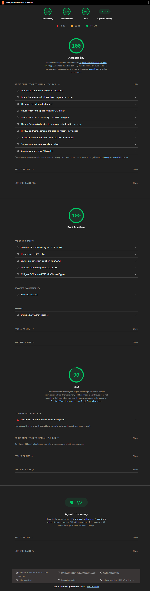
  - 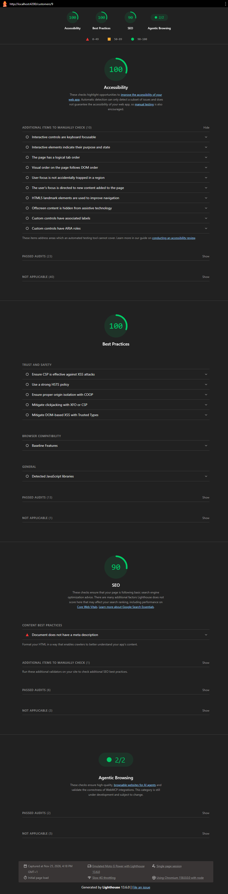
  - 
  - 
  - 
- Vistas finales, con el CSS de `1e08acd`:
  - 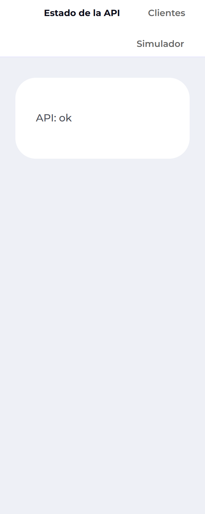
  - 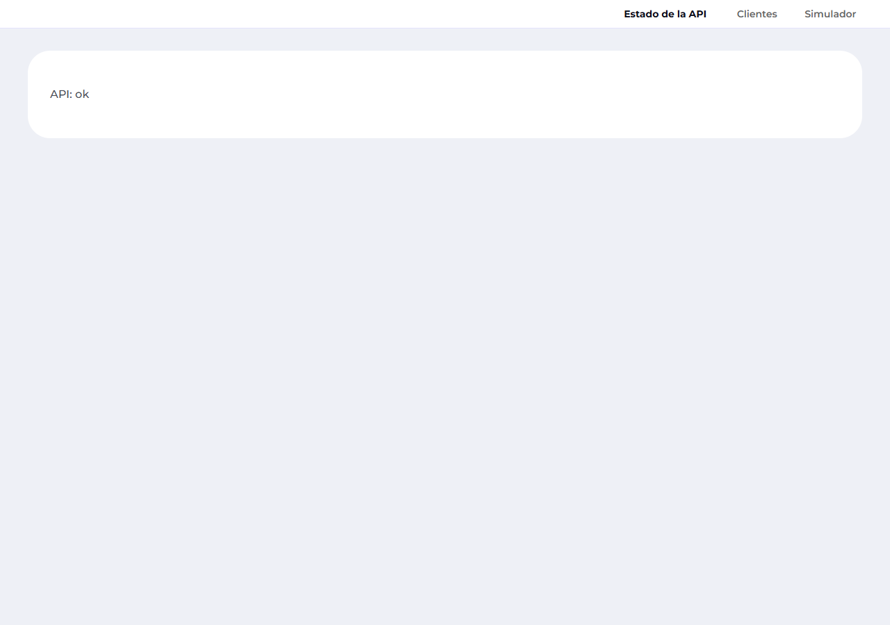
  - 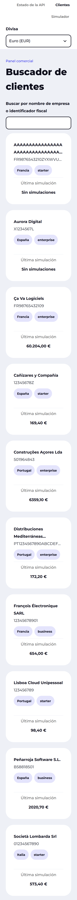
  - 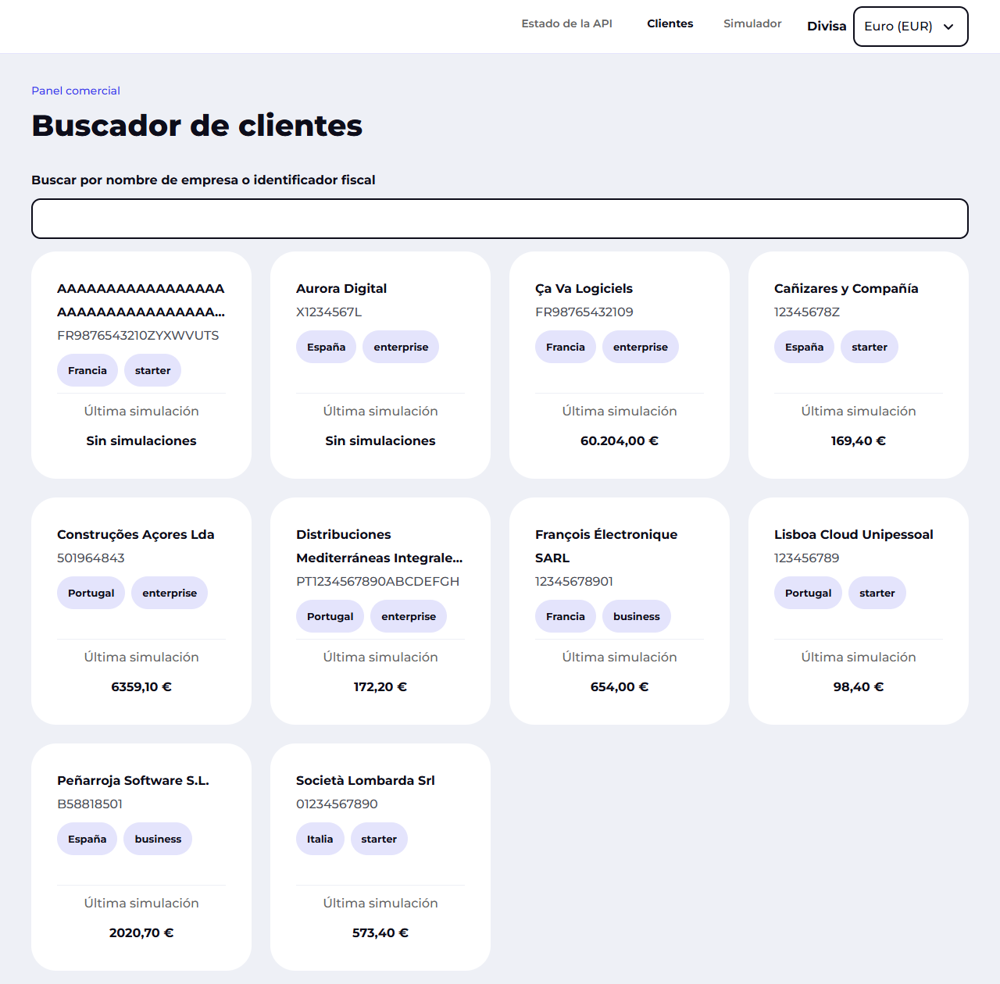
  - 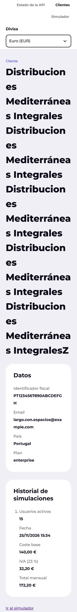
  - 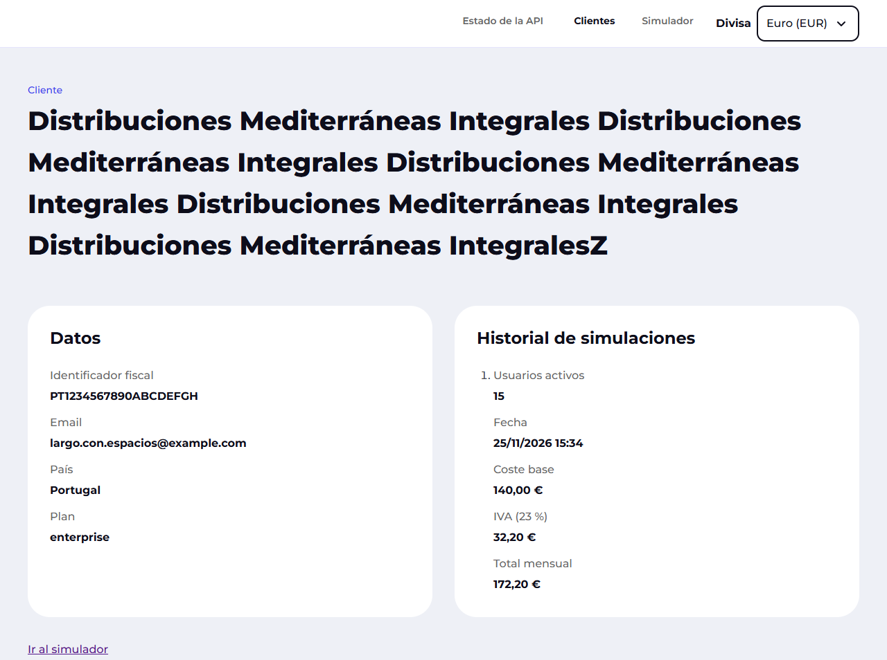
  - 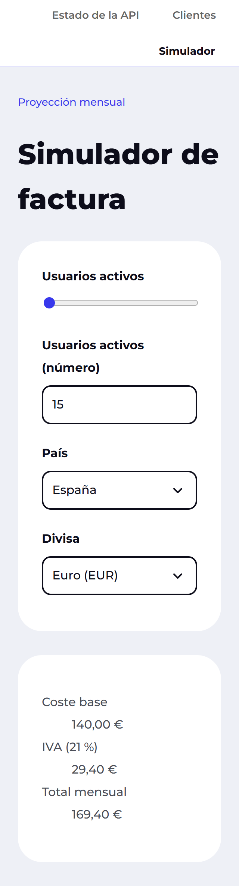
  - 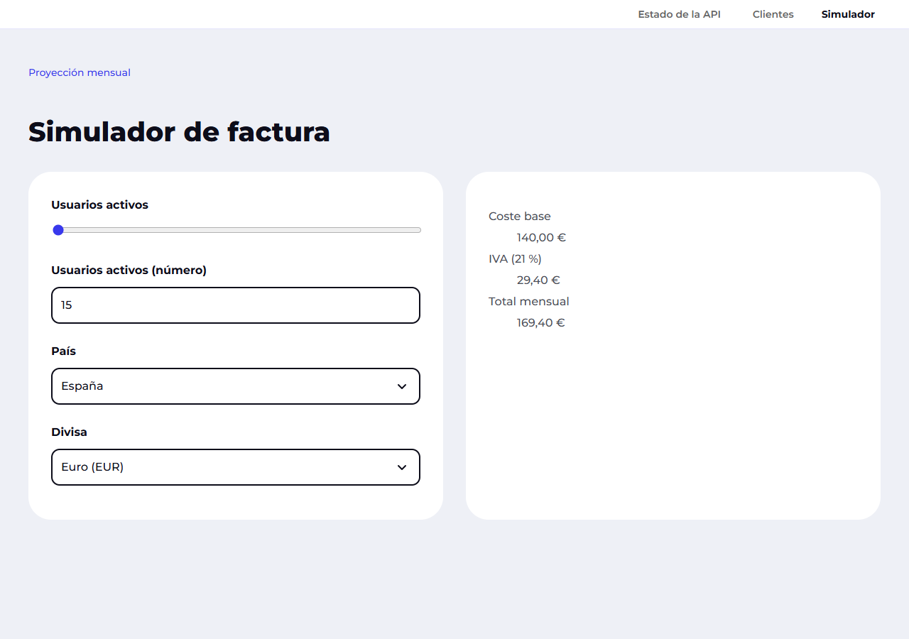
- Firefox, del autor:
  - 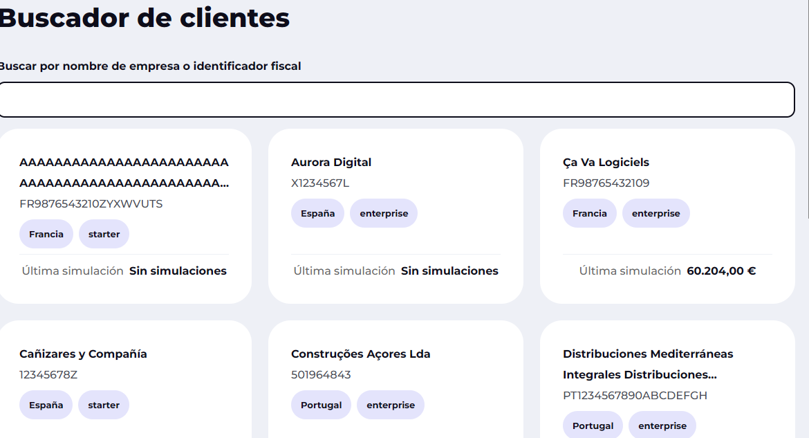
  - 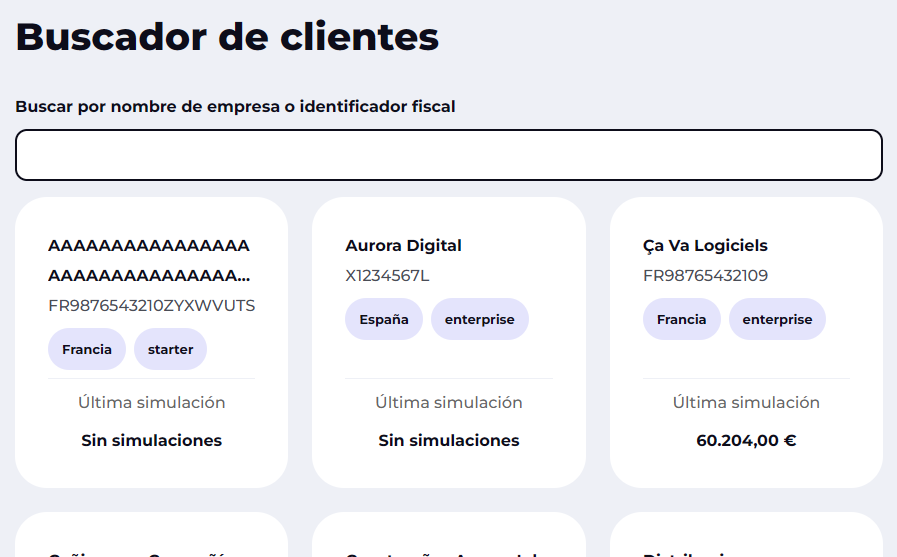
  - 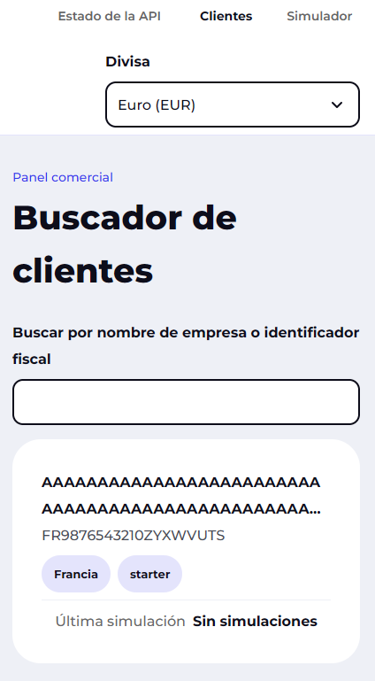
  - 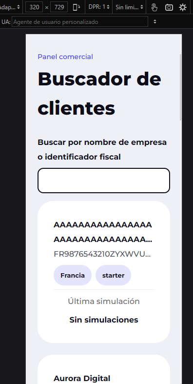
  - 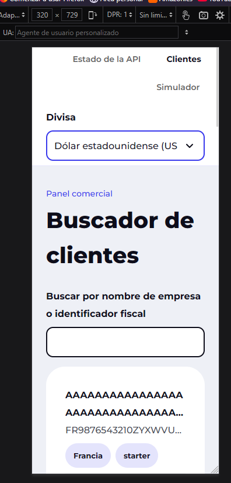
  - 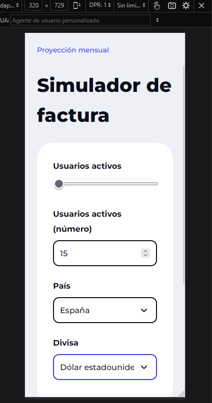
  - 
- Revisor y teclado:
  - 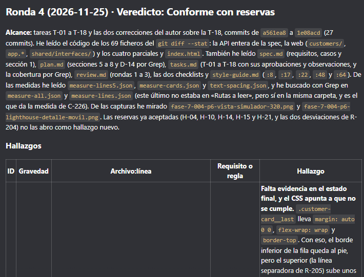 (renombrada: tenía un espacio antes de «.png»)
  - 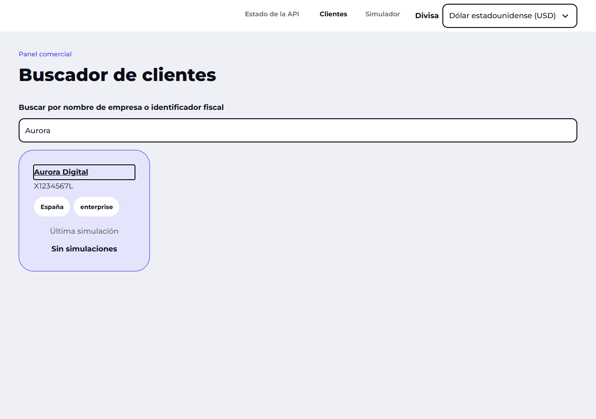
- C-238 con el CSS final, del autor (H-41; resultado literal en «Decisiones tomadas»):
  - 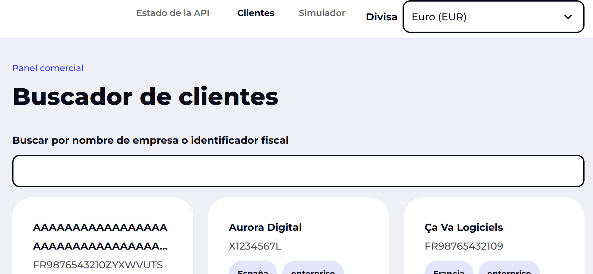
  - 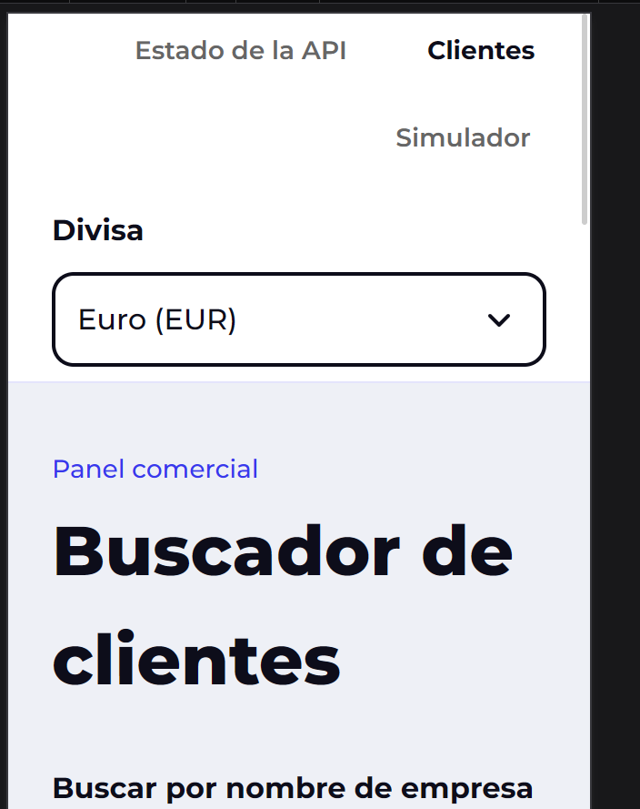

## Pendiente para la siguiente sesión
- Al terminar: parar la API (PID 27172, puerto 3000) y `ng serve` (PID 26392, puerto 4200), comprobando con `netstat` y `taskkill /T`.
- Fase final: README y validación con los criterios del §4.
- Después de cerrar la 004 y del README, el `/sdd-change` del autor con cinco cambios: (1) selector de divisa junto al buscador y, en el detalle, a la derecha del nombre; (2) texto que identifique el identificador fiscal en la tarjeta; (3) tarjeta en filas «etiqueta → valor» (reescribe R-204); (4) retroceso al buscador en cada vista; (5) toda la tarjeta clicable (R-105, R-202, R-203 y R-212).
- Después de la entrega: revisar `SKILL.md:42` (H-40).
- Reservas de la 004 pendientes, en `MEMORY.md` («Próximos pasos»).
