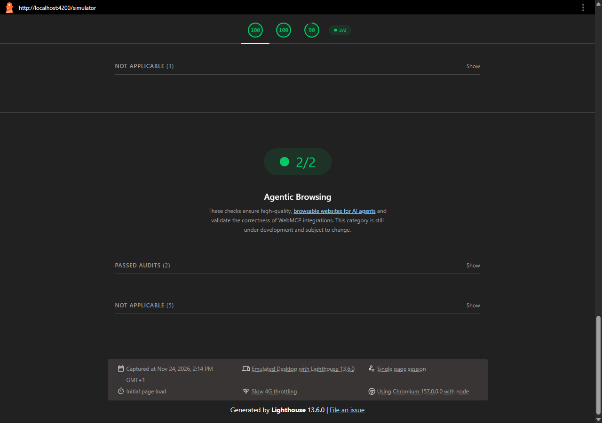

# 004-customers — Fase 7 (2026-11-25, sesión 18)

## Objetivo y fase
Fase 7, fase final: repaso del proyecto con los cuatro criterios de §4 y la evidencia de cada uno (ambigüedad #10). Es un documento breve en `ai-workspace/docs/`, enlazado desde el README. Se cierra con MEMORY.md → `/sdd-session` → commit; el push lo hace el autor.

## Prompts clave
> ## Decisiones
> 1. Fase final, último paso: repaso del proyecto con los cuatro criterios de §4 y la evidencia de cada uno (ambigüedad #10 del reto, que decía que no detallaban cómo se puntúan). Propón primero el esquema y el contenido, sin escribir; escribe solo con mi OK.
> 2. Dónde va: un documento breve en `ai-workspace/docs/` (propón el nombre) enlazado desde el README, no más README.
> 3. Cada criterio con su evidencia, citando ficheros y comandos reales, sin inventar cifras:
>    - 1. Planificación y diseño (35 %): specs 000 a 005 con sus puertas, constitución, arquitectura, base de datos, número de requisitos, casos y decisiones.
>    - 2. Criterio técnico y control de calidad (25 %): rondas del revisor independiente por spec y sus veredictos, reservas aceptadas con su motivo, y casos donde la IA se corrigió.
>    - 3. Calidad del software (30 %): 913 + 324 tests, validaciones de la API (400, 404, 409), importes enteros, Lighthouse, WCAG 2.2 AA y las limitaciones conocidas.
>    - 4. README y despliegue (10 %): clon limpio probado, en Windows 11 y en Windows 10 desde el ZIP, con lo que falló con Node 18.
> 4. Incluye una sección «Lo que no se cumple o queda pendiente», honesta: desviaciones de R-204, H-40, el aviso de presupuesto, la web de solo lectura, no probado en macOS ni Linux, y las mejoras previstas.
> 5. Pasar la ambigüedad #10 a «Dudas abiertas» de la spec que corresponda no aplica (no es de ninguna spec): anótala como decidida aquí, con la fecha.
>
> ## Acciones
> 1. Enséñame el esquema y las evidencias que citarás (comandos y ficheros comprobados). Espera mi OK.
> 2. Tras el OK, escribe el documento, enlázalo desde el README y enséñame los diffs. Orden de cierre: MEMORY.md → /sdd-session → commit. El push lo hago yo.
>
> ## Límites
> - Solo el documento nuevo, README.md, MEMORY.md y el registro. Sin tocar apps/ ni .claude/. Sin Co-Authored-By. Sin datos personales ni rutas locales.

> OK a la propuesta del repaso con tres respuestas: (1) el nombre `ai-workspace/docs/evaluation.md` vale, pero el contenido va en español (principio 8: los archivos en inglés, la documentación en español, como architecture.md y database.md); (2) la ambigüedad #10 queda como «se responde con este repaso, sin puntuación propia», decidida el 2026-11-25; (3) apruebo el matiz de WCAG: «objetivo WCAG 2.2 AA (principio 7), comprobado con…», no «cumple». Añade la línea al README bajo «Criterios de evaluación», como propones. Escribe el documento y enséñame los diffs del documento, del README y de MEMORY.md (50 líneas). Cada cifra y cada cita sale de una comprobación real; si algo no se puede comprobar, di «no comprobado». Con mi OK, lanzo /sdd-session y propones el commit, sin Co-Authored-By. El push lo hago yo.

> OK a evaluation.md, al diff del README y al de MEMORY.md, con tres correcciones:
> 1. H-20 de la 005 está resuelta (capturas rehechas con el modo visible, registro 2026-11-24-12-005-simulator, y existen fase-7-005-lighthouse-movil-final.png y fase-7-005-lighthouse-escritorio-final.png). Cambia en evaluation.md, en el apartado de Lighthouse de la 005, «Las capturas no distinguen el modo, reserva H-20» por: «en la 005, el simulador, con capturas de móvil y escritorio que muestran el modo en el pie (H-20, resuelta tras la ronda 4 con capturas rehechas)». Verifica que es cierto abriendo las dos capturas -final y dímelo; si en alguna no se ve el modo, déjalo como estaba.
> 2. Corrige lo mismo en la línea nueva de MEMORY.md («Lighthouse con sus matices (H-20 de la 005; …)»): quita la mención de H-20 como matiz y deja solo el matiz de la 004 (el revisor miró una captura de ocho).
> 3. En esa misma línea, «Solo probado en Windows 11» pasa a «Solo probado en Windows 11 y Windows 10».
> Sobre tus dos preguntas: la regla de «pasar cada ambigüedad a Dudas abiertas» puede quedar fuera de MEMORY.md porque sigue en CLAUDE.md, «Huecos del reto». Mantén MEMORY.md en 50 líneas y enséñame los tres cambios. Con mi OK, lanzo /sdd-session y propones el commit, sin Co-Authored-By. El push lo hago yo.

> OK a las tres correcciones y a los diffs de evaluation.md, README.md y MEMORY.md. Lanzo yo /sdd-session 7 004-customers; después propón el commit con evaluation.md, README.md, MEMORY.md y el registro, sin Co-Authored-By. El push lo hago yo.

## Qué propuso la IA
- **Evidencia reunida antes de proponer:**
  - Leyó §4 en `reto.md`.
  - Leyó la lista literal de ambigüedades de la sesión 00, que en la línea 95 dice: «Criterios de evaluación… Ninguno tiene detalle de cómo se puntúa».
  - Revisó el README, las capturas de Lighthouse y las líneas citadas de `review.md` y de las sesiones.
- **Primeros recuentos:** contó con regex que buscaba menciones y le salieron cifras distintas de MEMORY.md (001: 21 frente a 20; 003: 42 frente a 41; 005: 101 frente a 99). Los rehízo contando solo definiciones (`**R-nn.**`, filas `| C-nn |`, D-nn de `plan.md`, T-nn de `tasks.md` y filas `| #n |`):

| Spec | Requisitos | Casos | Decisiones | D-nn | Tareas |
|---|---|---|---|---|---|
| 000 | 32 | 41 | 38 | 18 | 24 |
| 001 | 20 | 27 | 13 | 6 | 4 |
| 002 | 35 | 52 | 34 | 14 | 7 |
| 003 | 41 | 41 | 25 | 16 | 6 |
| 004 | 232 | 239 | 51 | 17 | 18 |
| 005 | 99 | 54 | 32 | 18 | 11 |
| **Total** | **459** | **454** | **193** | **89** | **70** |

- **Otras cifras contadas:**
  - 17 ADR.
  - 27 rondas del revisor: 1 `Cambios requeridos` (la ronda 1 de la 000, con H-01 `Bloqueante`) y 26 `Conforme con reservas`.
  - 118 sesiones.
- **`npm run verify` en el árbol del día:** en verde.
  - `Tests  913 passed (913)` y `Tests  324 passed (324)`.
  - Aviso de presupuesto: 723,37 kB frente a 500 kB.
- **Propuesta:** `ai-workspace/docs/evaluation.md` con cabecera (ambigüedad #10), los cuatro criterios y la sección «Lo que no se cumple o queda pendiente», más una línea en el README bajo «Criterios de evaluación». Hizo tres preguntas: el nombre, la redacción de la #10 y el matiz de WCAG («objetivo… comprobado con», no «cumple», porque Lighthouse no prueba por sí solo el nivel AA).
- **Documento escrito tras el OK:**
  - Se comprobaron los 23 enlaces relativos y todos existen.
  - Se anotó como no comprobado por la IA lo que no vio directamente: en la 004, el revisor miró una captura de Lighthouse de ocho; la prueba en Windows 10 la hizo el autor; el clon limpio de Windows 11 se toma del README y de la sesión 16; macOS y Linux, «no comprobado».
- **Dos preguntas sobre MEMORY.md:** si conservar la regla «pasar cada ambigüedad a "Dudas abiertas"», que había quitado junto con el «Pendiente», y si corregir «Solo probado en Windows 11».
- **Comprobación de H-20:** abrió las dos capturas «-final» de la 005. En el pie se leen «Emulated Moto G Power with Lighthouse 13.6.0» (móvil) y «Emulated Desktop with Lighthouse 13.6.0» (escritorio). El registro 2026-11-24-12-005-simulator no se abrió.

## Qué corregí y por qué
- **El contenido de `evaluation.md` va en español:** el nombre del fichero va en inglés y la documentación en español (principio 8).
- **H-20 de la 005:** la IA lo presentaba como un matiz pendiente, pero está resuelta: las capturas se rehicieron con el modo visible. Cambié la frase en `evaluation.md` y quité el matiz de MEMORY.md.
- **MEMORY.md:** «Solo probado en Windows 11» pasa a «Solo probado en Windows 11 y Windows 10».
- **Regla de las ambigüedades:** puede quedar fuera de MEMORY.md porque sigue en CLAUDE.md, «Huecos del reto».
- **Por qué, en lo demás:** (no registrado).

## Decisiones tomadas
- **Ambigüedad #10, decidida por el autor el 2026-11-25:** «se responde con este repaso, sin puntuación propia». No es de ninguna spec.
- **Documento:** `ai-workspace/docs/evaluation.md`, con el contenido en español, enlazado desde el README bajo «Criterios de evaluación».
- **WCAG:** «objetivo WCAG 2.2 AA (principio 7), comprobado con…», no «cumple».
- **MEMORY.md:**
  - Pendiente de la fase final sustituido por el repaso hecho, con el matiz de Lighthouse de la 004 solamente.
  - «Solo probado en Windows 11 y Windows 10».
  - Sigue en 50 líneas.
- **Ficheros tocados:** solo `evaluation.md`, `README.md`, `MEMORY.md` y este registro; ni `apps/` ni `.claude/`.
- **Commit:** el de cierre de esta sesión.

## Capturas
- No hay capturas nuevas en esta sesión ni ninguna línea `CAPTURA:` anunciada.
- **Abiertas para comprobar H-20, sin cambios:**

- **Momento que se podría capturar:** `evaluation.md` en la vista previa de GitHub tras el push.

## Pendiente para la siguiente sesión
- Commit de cierre de esta sesión (`evaluation.md`, `README.md`, `MEMORY.md` y este registro) y push del autor.
- `/sdd-change` del autor con los cinco cambios de la interfaz (MEMORY.md, «Próximos pasos»).
- Reservas abiertas de cada spec, en MEMORY.md, «Próximos pasos».
