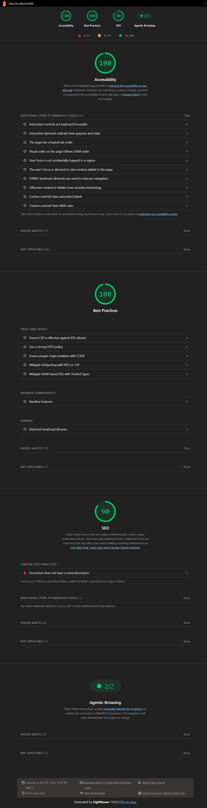
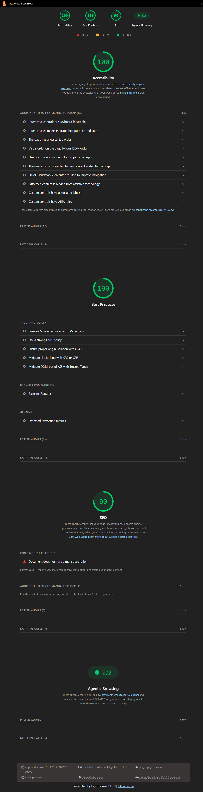

# 004-customers — Fase 7 (2026-11-25, sesión 22)

## Objetivo y fase
Fase 7, spec `004-customers`, puerta 6 (validación) tras la T-19 y la T-20, que aplicaron las Decisiones 2026-11-25 #7 a #10. La sesión pasa la spec a `En revisión`, comprueba con comandos y Lighthouse, lanza dos rondas del revisor (7 y 8) y vuelve a cerrar la spec, con reservas, el mismo día.

## Prompts clave
> /sdd-validate 004-customers

> 1. Chrome: te autorizo a cerrar solo el Chrome cuyo perfil sea chrome-devtools-mcp, tras ver su línea de órdenes. No toques mi Chrome personal; si hay duda, para y dímelo.
> 2. Alcance: (a), Lighthouse en las cuatro vistas, móvil y escritorio, y nada más. Descarto la captura.
> En el encargo del revisor, incluye como ya aceptadas por mí, con mi motivo literal de tasks.md: el riesgo 24 (C-260), Firefox (Q-07 y C-238) y el historial a 320 px como observación. Enséñame el encargo antes de lanzarlo.

> Corrige tasks.md:16 (T-20 en [x]) como consecuencia directa de la regla de la #4 y anótalo en el registro. Deja las cinco comprobaciones y la agrupación de pruebas sin evidencia en un solo hallazgo. Lanza al revisor tal cual.

> Guarda la ronda 7 en review.md con los signos reales. H-48: opción (a): haz las ocho capturas finales de Lighthouse (fase-7-004-p6-lighthouse-final-<vista>-<dispositivo>.png) sin tocar las de la sesión 15; mi «Descarto la captura» era solo del aviso CAPTURA: de la elección del alcance. H-49, H-50, H-51, H-52, H-53 y H-54: los acepto como reservas Menor/Importante, nombrándolos; motivo mío: el plazo de entrega es hoy a las 23:00 y no se han medido a mano los casos de navegador de la #7 (H-49, grupos 1 a 9); H-51 ya lo había aceptado de antemano. Lanza una ronda 8 limitada a H-48. Descarto la captura de la ronda 7.

Aprobación de cierre (literal; también al final de `review.md`):

> Guarda la ronda 8 en review.md con los signos reales. Descarto la nota del Slow 4G y la captura de la ronda 8.
>
> Apruebo el cierre de la 004 con reservas, nombradas una a una:
> - Abiertas de antes: H-04, H-10, H-14, H-15, H-21, H-36, H-37, H-38, H-40, H-41, H-42, H-46 y los cinco Menores de la ronda 6 (citas a C-64 en R-239 y spec.md:900; R-265 sin «Sin simulaciones»; C-238 y C-239 sin R-265; ningún enlace activo en «/» sin caso; R-265 compuesto).
> - De la T-20, con mi motivo literal de tasks.md: el riesgo 24 frente a C-260, Firefox de la Q-07 y de C-238, y el historial a 320 px como observación.
> - De la ronda 7: H-49 (Importante: los casos de navegador de la #7 sin medir a mano, grupos 1 a 9), H-50, H-51 (ya aceptada de antemano), H-52, H-53 y H-54. H-48 queda resuelto con las ocho capturas.
> Motivo mío de las nuevas: el plazo de entrega es hoy a las 23:00 y no hay tiempo de medirlas a mano ni de rehacer las puertas 3 y 4.
>
> Copia esta aprobación literal al final de review.md, pasa el Estado a Cerrada en spec.md y en el README de specs, actualiza MEMORY.md y enséñame el diff.

> Aprobado el diff de MEMORY.md, con un ajuste: en la frase de H-48, di que «Descarto la captura» se refería solo al aviso CAPTURA: de la elección del alcance y se aplicó también a los informes, sin decir que se leyó mal. Para ahora los servidores 3100 y 4300. Lanzo /sdd-session 7 004-customers.

## Qué propuso la IA
- **Inicio de la puerta 6:**
  - `Estado:` de `En implementación` a `En revisión` en `spec.md:3` y en la fila 004 de `specs/README.md`.
  - `npm run verify` (22:14): código 0, 913 + 324, con el aviso de presupuesto ya aceptado (725,16 kB).
  - `git status` y `git diff --stat` del árbol y de `1a7cb8c..HEAD`: de `apps/` solo cambian los cinco ficheros que permiten la T-19 y la T-20.
- **Chrome del MCP:**
  - El perfil `chrome-devtools-mcp` estaba bloqueado por un Chrome anterior. La IA paró y preguntó, junto con el alcance (opciones (a), (b) y (c), con la (a) recomendada), porque el plazo era las 23:00.
  - Con la autorización del autor cerró solo el proceso principal (PID 32108), con `--user-data-dir=…\.cache\chrome-devtools-mcp\chrome-profile` y `--enable-automation`, y su árbol, tras ver su línea de órdenes.
- **Lighthouse:** modo navegación, sobre `ng serve` en el 4300 y la API del scratchpad en el 3100, con la base de la T-20. Se pasó en `/customers`, `/customers/4`, `/simulator` y `/`, en móvil y escritorio.
  - Las ocho dan accesibilidad 100, buenas prácticas 100, SEO 90 (solo `meta-description`) y navegación con agentes 100.
  - En `/customers/4` en móvil sale además `cumulative-layout-shift` 0,05 (puntuación 0,99).
- **Encargo de la ronda 7:** se enseñó antes de lanzarlo, en `encargo-revisor-ronda7.md` del scratchpad.
  - Llevaba la petición literal del autor, las Decisiones #7 a #10, la Q-07, la aprobación de la ronda 6, las tres reservas de la T-20 con su motivo literal, la salida literal de `verify`, `git status` y los `--stat`, Lighthouse y la lista de pruebas a mano no hechas.
  - La IA avisó de dos añadidos suyos que el autor no había nombrado: las cinco comprobaciones y la agrupación de las pruebas sin evidencia en un solo hallazgo.
  - También avisó de que `tasks.md:16` todavía decía «T-20, en `[ ]`».
  - Tras corregir `tasks.md:16`, ajustó el punto 2 del encargo y añadió una línea tras `git status` para no decir nada falso. Se lo dijo al autor al lanzarlo.
- **Ronda 7, `Cambios requeridos`:**
  - H-48, Bloqueante: R-71 y R-148, faltaban las capturas de Lighthouse del CSS final.
  - H-49, Importante: los casos de navegador de la #7 sin evidencia, grupos 1 a 9.
  - H-50 a H-54, Menores.
  - La IA comprobó H-48 (las ocho capturas que había eran de las 16:23–16:24) y H-50 (`spec.md:1034`). Reconoció que H-48 salía de cómo aplicó «Descarto la captura» en el encargo, y dio tres opciones, con la (a) recomendada.
- **Ronda 7 guardada** en `review.md` (desde la línea 754), con ` ` y `<nav>` reales.
- **H-48:** ocho capturas de página completa de los `report.html` de hoy, hechas con `take_screenshot`, como `fase-7-004-p6-lighthouse-final-<vista>-<dispositivo>.png`. Las de la sesión 15 no se tocaron.
- **`Estado:`:** con `Cambios requeridos` vuelve a `En implementación`, y la ronda 8 lo pasa a `En revisión`, así que el texto no cambió.
- **Ronda 8** (Opus, effort «High»), limitada a H-48:
  - Se lanzó sin enseñar antes el encargo, porque el autor pidió lanzarla; está en `encargo-revisor-ronda8.md` del scratchpad.
  - Salió `Conforme con reservas`, sin hallazgos nuevos y con H-48 resuelto: cada captura cuadra con su `report.json` en URL, dispositivo, hora y versión.
  - Trajo una observación sin hallazgo: el «Slow 4G throttling» de los informes de escritorio.
- **Ronda 8 y aprobación del autor** guardadas al final de `review.md` (líneas 913 y 990), con `<vista>` y `<dispositivo>` reales.
- **Cierre:** `Estado: Cerrada` en `spec.md:3` y en el README. `MEMORY.md` actualizado (50 líneas) y su diff enseñado.
- **Servidores del scratchpad:** se pararon con su árbol de procesos tras ver su línea de órdenes:
  - la API: `tsx` (PID 34028) con su hijo en el 3100;
  - la web: `cmd` (PID 37036) con `ng serve` en el 4300.
  - `netstat` ya no muestra nada en el 3100 ni en el 4300. El `npm run dev` del autor (3000 y 4200) sigue arrancado.

## Qué corregí y por qué
- **`tasks.md:16`** decía «T-20, en `[ ]`», con la T-20 en `[x]` (`:461`). Lo corregí como consecuencia directa de la regla de la Decisión 2026-11-25 #4. Ahora dice: «T-19 y T-20, en `[x]`, cada una con su aprobación literal del autor (puerta 4 rehecha tras la Decisión 2026-11-25 #7).»
- **H-48:** mi «Descarto la captura» se refería solo al aviso `CAPTURA:` de la elección del alcance y se aplicó también a los informes de Lighthouse. Elegí hacer las ocho capturas finales sin tocar las de la sesión 15.
- **`MEMORY.md`:** pedí que la frase de H-48 lo diga así, sin decir que se leyó mal.
- **Nota del «Slow 4G» de la ronda 8:** la descarté.

## Decisiones tomadas
- Alcance de la puerta 6: (a), Lighthouse en las cuatro vistas, móvil y escritorio. Las pruebas a mano de la #7 no se hacen.
- Las tres reservas de la T-20 entran en el encargo como aceptadas, con el motivo literal del autor.
- H-48 resuelto con las ocho capturas `fase-7-004-p6-lighthouse-final-…`.
- H-49 a H-54 aceptados como reservas, con el motivo del autor: el plazo de entrega, hoy a las 23:00.
- Cierre de la spec 004 aprobado con todas las reservas nombradas (literal en `review.md`).
- `Estado: Cerrada` en `spec.md` y en el README de specs. `MEMORY.md` al día.
- `npm run verify` en verde: 913 + 324.
- Commit: el de cierre de esta sesión.

## Capturas

Anunciadas y no existentes, descartadas por el autor:
- `fase-7-004-p6-alcance-puerta-6`: «Descarto la captura».
- `fase-7-004-p6-ronda-7-revisor`: «Descarto la captura de la ronda 7».
- `fase-7-004-p6-ronda-8-revisor`: «Descarto … la captura de la ronda 8».

## Pendiente para la siguiente sesión
- El commit de cierre, sin `Co-Authored-By`: `review.md`, `spec.md`, `tasks.md`, el README de specs, `MEMORY.md`, las ocho capturas y este registro.
- Reservas de la 004 pendientes, apuntadas en `MEMORY.md`.
- Los cinco cambios anotados para otro `/sdd-change` siguen pendientes (decisión del autor).
- Push de `cambios-interfaz`: (no registrado).
